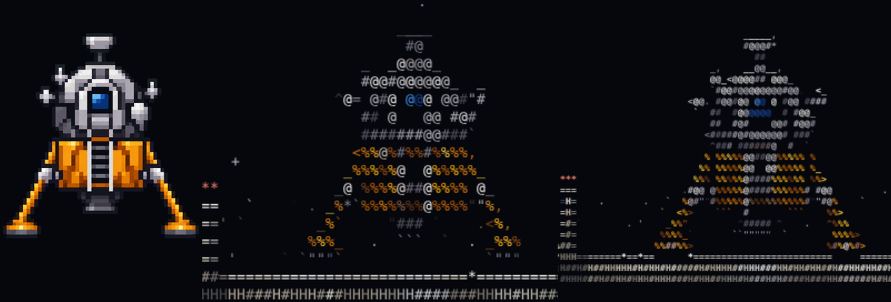
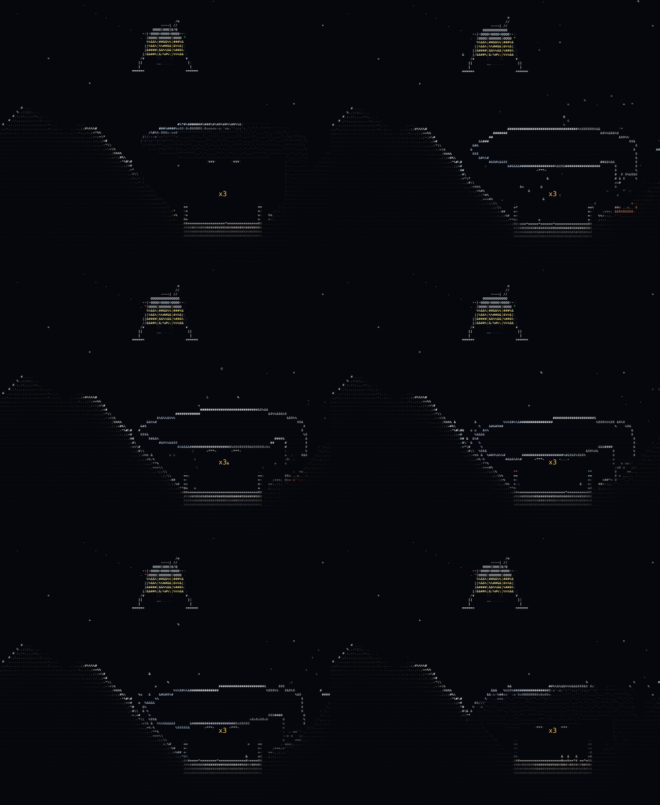

# Glyphite + Regolith Lander

**Glyphite** is a 2D game engine for the browser that draws everything with the 95 printable ASCII
characters, each with its own colour. It started as a moon-lander experiment and is growing into a
complete, reusable engine for any 2D game. **Regolith Lander** is the test game built on it.


## What the engine does today

- **Voxel world.** A grid of materials (regolith, basalt, bedrock, ice, steel, crystals...) where
  every cell can be blasted, heated, scoured or fused. Loose regolith and rubble fall and slide in a
  cellular-automaton sand simulation.
- **Rigid bodies** that collide with the grid using impulse contacts and friction. The lander uses
  spring-damper landing legs; boulders and broken structures use the same solver.
- **Structures break where they are hit.** After every blast, anything left without support breaks
  off as a rigid piece. It falls and tumbles, chips apart if it is brittle, and settles back into
  the grid. Lamp posts topple with their lamp still shining, and the x3 pad's roof collapses when
  its pillar is shot away.
- **Lighting.** Exact sun shadows, ambient occlusion and surface normals from summed-area tables,
  point and cone lights with shadows, light that soaks into the ground, emissive heat and crystals,
  and a tone map with vignette and optional bloom.
- **Particles and VFX.** Grains that go back into the world when they land, exhaust that scours
  the ground, fire, sparks, smoke, vapour, debris, shock rings, flashes, screen shake and slow
  motion.
- **ASCII rendering.**
  - A WebGL glyph-atlas shader in one pass, with a 2D-canvas fallback.
  - A smoothly scrolling world layer and a separate sky layer with parallax.
  - A fixed, readable HUD grid.
  - Detail levels from 1x to 3x characters per metre.
- **Sprites.** Pixel art is converted into a palette sprite, then drawn as glyphs that match its
  shapes, rotated and lit. The tools are `tools/sprite2ascii.py` (image → sprite data) and
  `tools/ascii_preview.py` (instant ASCII preview); the workflow is the
  `glyphite-pixel-art-to-ascii` skill.
- **Chip.** An NES 2A03-style sound chip:
  - pulse, triangle and noise channels, played from Standard MIDI Files;
  - live input from a MIDI keyboard through Web MIDI;
  - an original soundtrack, plus drag-and-drop of your own `.mid` files.

## The test game: Regolith Lander

Land on the pads at eight lunar sites. The x2 and x3 pads pay double and triple; the x3 pad sits
under a rock overhang. Watch your fuel. Use rockets to blast rock, free glowing He-3 crystals,
topple lamp posts or bring the roof down. Meteor showers arrive on later sites. Touch down under
1 m/s for a bonus. Above about 4 m/s the legs collapse.

Controls:
- W / Up: burn the engine.
- A D / Left Right: rotate.
- Space or click: fire a rocket (aim with the mouse).
- L: lights. G: bloom.
- `-` / `+`: detail level.
- P / Esc: pause.
- M: sound. N: music. V: sound-chip meters.
- Enter: continue. R: retry after a crash.
- Touch screens get on-screen buttons.

| | |
|---|---|
|  |  |

## Build and run

```sh
./build.sh                 # concatenates src/ -> dist/regolith.html (and dist/test.html)
open dist/regolith.html    # or any browser; append #2d or #gl to force a renderer
```
No dependencies at runtime. Building needs `sh` and Node (for a syntax check). The tests need
Python 3, Playwright (`pip install playwright pillow numpy && playwright install chromium`).

## Documentation

- [CLAUDE.md](CLAUDE.md): working guide for Claude Code (layout, commands, rules, verification).
- [docs/HISTORY.md](docs/HISTORY.md): how the project was built, request by request.
- [docs/ARCHITECTURE.md](docs/ARCHITECTURE.md): deep dive into every subsystem.
- [docs/LESSONS.md](docs/LESSONS.md): bugs, decisions and pitfalls worth remembering.
- [docs/ROADMAP.md](docs/ROADMAP.md): the plan to make Glyphite a game-agnostic engine, plus the backlog.
- [docs/TESTING.md](docs/TESTING.md): the test and probe scripts.
- `.claude/skills/`: `glyphite-pixel-art-to-ascii` and `glyphite-verify`.
