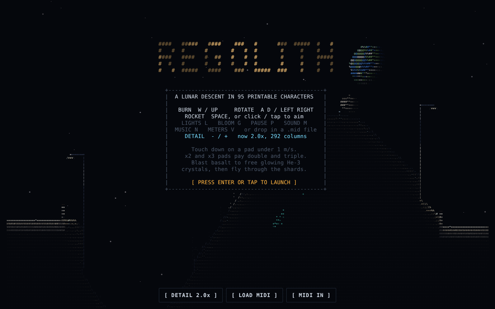

# Glyphite

**Glyphite** is an AI-first game engine for the browser that draws everything with the 95 printable ASCII
characters, each in its own colour. Games are made and changed in Claude Code sessions on this repository, and
live at **glyphite.hornbaek.org**. Visitors who are not signed in see a landing page about the engine with a live demo;
behind the Cloudflare Access login are the games, the web editor, the idea bank and each game's reference art.



## The games

| Game | |
|---|---|
| [Regolith Lander](games/regolith/) | Land on the pads at eight lunar sites, blast rock for He-3, bring structures down. The engine's first and reference game. |
| [Space Mouse](games/spacemouse/) | A platformer: a mouse in a space suit crosses a dark, abandoned station looking for cheese. Eat through cheese, stomp cat-bots, ride a falling gantry, spacewalk in low gravity. The walking reference (engine `Character`, back walls). |

New games start from `templates/starter/` (Cave Drone): `node tools/glyphite.mjs new <id> --title "…"`.

## What the engine does

- **Voxel world** of game-defined materials. Every cell can be blasted, heated, scoured or fused, and sand
  falls and slides in a cellular-automaton simulation.
- **Rigid bodies** that collide with the grid using impulse contacts and friction.
- **Structures break where they are hit.** Anything left without support breaks off as a rigid chunk that
  falls, tumbles, chips and settles back into the grid, carrying the objects mounted on it.
- **Lighting**: exact sun shadows (or no sun at all), ambient occlusion, surface normals, point and cone lights
  with shadows, light that soaks into the ground, emissive materials, bloom.
- **Particles and VFX**: grains that become terrain again, exhaust that scours the ground, fire, sparks, smoke,
  shock rings, flashes, shake, slow motion, and game-defined particle types.
- **ASCII rendering**: a WebGL glyph-atlas shader (2D canvas fallback), a smooth-scrolling world layer, a
  parallax sky layer the game can paint, a readable HUD grid, and detail levels from 1x to 3x characters per metre.
- **Sprites**: pixel art drawn as glyphs that match its shapes, rotated and lit, with moving parts
  (`tools/sprite2ascii.py` converts images).
- **Chip**: an NES 2A03-style sound chip that plays Standard MIDI Files, plus procedural sound effects.
- **Made for AI sessions**: one documented API (`engine/API.md`), a starter game, a scaffold command, tunables
  the web editor exposes, a probe/test API (`Glyphite.test`) and a smoke test that works for any game.

## Use it

```sh
npm install              # wrangler, for the Worker; the engine and games need nothing
npm run build            # → dist/: the site, every game as one HTML file, editor sources
npm run serve            # http://localhost:8787 (open dist/games/<id>/index.html directly works too)
npm test                 # unit tests; python3 tests/smoke.py --all for every game in a browser
```

## The web editor

Every game has an **EDIT** page with three tabs:
- **Tune**: sliders for the numbers the game exposes (gravity, thrust, fuel…). Live ones change the running
  preview at once.
- **Code**: the game's and the engine's source, editable, rebuilt into the preview in the browser (Ctrl/Cmd+S).
  Errors point at the source file and line.
- **Claude**: turns your edits into a prompt plus a `git apply` patch for a Claude Code session, which commits
  them through a pull request. Edits stay in your browser until then.

## Documentation

- [CLAUDE.md](CLAUDE.md): the working guide for Claude Code (layout, commands, rules, verification).
- [engine/API.md](engine/API.md): the engine API.
- [docs/ARCHITECTURE.md](docs/ARCHITECTURE.md): how every subsystem works.
- [docs/DEPLOY.md](docs/DEPLOY.md): Cloudflare setup (Worker, custom domain, Access login, CI deploy).
- [docs/IDEAS.md](docs/IDEAS.md): the idea bank, every feature the engine could have (inspiration, not a plan). On the site
  it is the **Idea bank** page, where you star ideas and set a status on each (stored in Cloudflare D1). The
  **What's new** page (built from [docs/HISTORY.md](docs/HISTORY.md)) lists what changed and when, and each game's **ART** page
  shows the original art its sprites were made from (every image given, every drawing cut from it).
- [docs/HISTORY.md](docs/HISTORY.md), [docs/LESSONS.md](docs/LESSONS.md), [docs/ROADMAP.md](docs/ROADMAP.md),
  [docs/TESTING.md](docs/TESTING.md).
- Skills in `.claude/skills/`: `glyphite-new-game`, `glyphite-verify`, `glyphite-pixel-art-to-ascii`.
