# Fjordheim: reference art

The owner's art sheets, untouched, and every drawing cut from them at its original pixels (`frames/`), used in the game
or not. Made by `tools/art.py`, which also writes `ref.json` (the site's ART page reads it). Boxes are x0, y0, x1, y1 on
the sheet.

## Ground, buildings, nature and the barley field

`sheet_buildings.jpg`, 1264 x 848, from Gemini

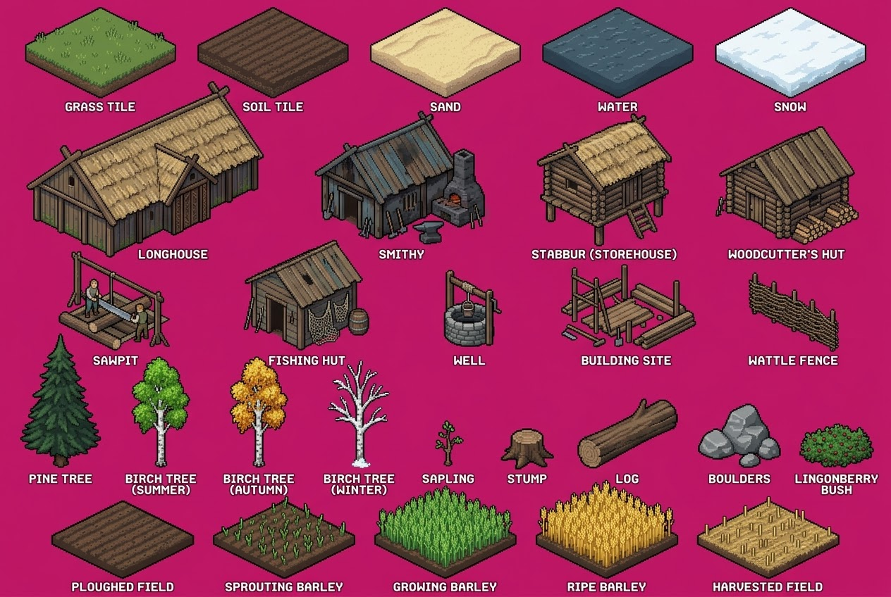

| drawing | name | box | used for |
|---|---|---|---|
| 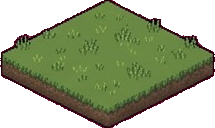 | tile grass | 34, 9, 251, 141 | the colour of the grass |
| 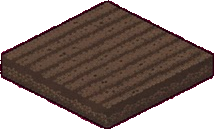 | tile soil | 279, 9, 496, 140 | the colour of tilled soil |
| 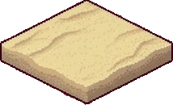 | tile sand | 524, 9, 740, 141 | the colour of the beach |
| 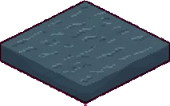 | tile water | 768, 9, 985, 141 | the colour of the fjord |
| 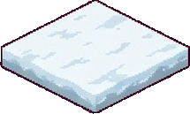 | tile snow | 1013, 9, 1230, 141 | the colour of snow |
| 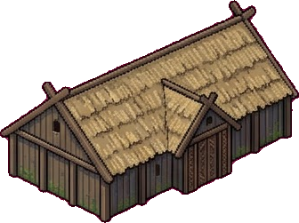 | longhouse | 37, 114, 375, 367 | the longhouse, the family's home |
| 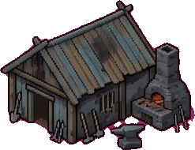 | smithy | 445, 143, 692, 349 | the smithy |
| 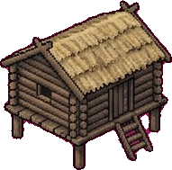 | stabbur | 761, 143, 954, 351 | the storehouse on stilts (stabbur) |
| 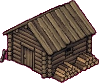 | woodcutter | 1014, 178, 1219, 349 | the woodcutter's hut |
| 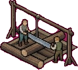 | sawpit | 82, 356, 242, 500 | the sawpit (two sawyers drawn in) |
| 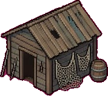 | fishing hut | 345, 340, 525, 499 | the fishing hut |
| 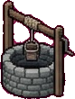 | well | 629, 383, 713, 494 | the well |
| 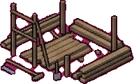 | building site | 795, 374, 989, 498 | any building under construction |
| 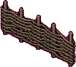 | fence | 1061, 386, 1191, 500 | not used yet: fences around fields |
| 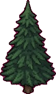 | pine | 28, 473, 144, 666 | pine trees |
| 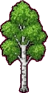 | birch summer | 186, 506, 271, 665 | birches in spring and summer |
| 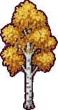 | birch autumn | 325, 503, 454, 665 | birches in autumn |
|  | birch winter | 464, 511, 554, 666 | birches in winter |
| 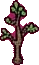 | sapling | 617, 596, 658, 663 | a young tree growing back |
| 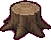 | stump | 710, 608, 787, 668 | a felled tree's stump |
| 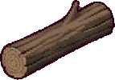 | log | 818, 565, 963, 667 | a felled tree (not drawn yet: the woodcutter carries it off at once) |
| 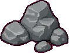 | boulders | 989, 572, 1109, 666 | boulders to quarry for stone |
| 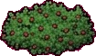 | lingonberry | 1133, 600, 1241, 665 | lingonberry bushes to pick |
| 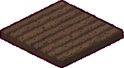 | field 0 | 71, 710, 277, 824 | a field, ploughed |
| 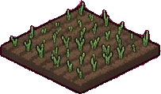 | field 1 | 301, 671, 505, 824 | a field, sprouting |
| 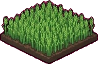 | field 2 | 529, 671, 734, 824 | a field, growing |
| 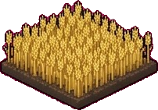 | field 3 | 759, 680, 963, 824 | a field, ripe |
| 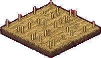 | field 4 | 987, 704, 1192, 842 | a field, harvested |

## The family, animals, boats and goods

`sheet_people.jpg`, 1264 x 848, from Gemini

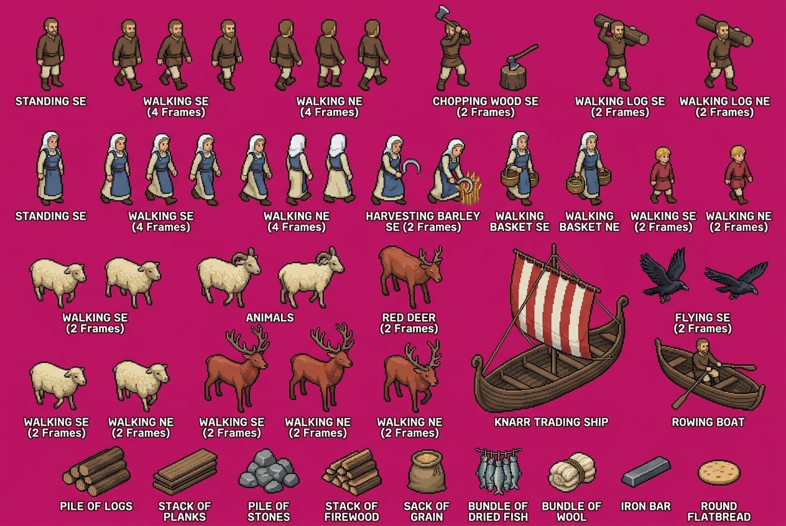

| drawing | name | box | used for |
|---|---|---|---|
| 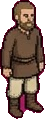 | father stand | 57, 27, 105, 148 | the father standing |
| 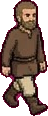 | father se 1 | 179, 29, 230, 148 | the father walking towards the viewer |
| 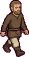 | father se 2 | 250, 29, 310, 147 | the father walking towards the viewer |
| 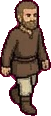 | father se 3 | 338, 29, 392, 148 | the father walking towards the viewer |
| 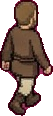 | father ne 1 | 433, 29, 488, 148 | the father walking away |
| 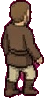 | father ne 2 | 505, 29, 557, 143 | the father walking away |
|  | father ne 3 | 575, 29, 628, 148 | the father walking away |
| 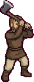 | father chop | 699, 7, 759, 148 | the father felling a tree (axe raised) |
| 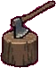 | chopping block | 802, 70, 867, 148 | not used: the woodcutter's hut has its own block |
| 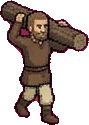 | father log se 1 | 954, 21, 1045, 148 | the father carrying a log towards the viewer |
| 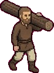 | father log se 2 | 1118, 21, 1212, 148 | the father carrying a log towards the viewer (drawn as "NE") |
| 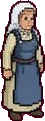 | mother stand | 57, 209, 105, 333 | the mother standing |
| 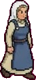 | mother se 1 | 160, 212, 215, 332 | the mother walking towards the viewer |
| 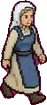 | mother se 2 | 232, 213, 287, 332 | the mother walking towards the viewer |
| 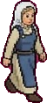 | mother se 3 | 302, 213, 358, 333 | the mother walking towards the viewer |
| 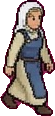 | mother se 4 | 383, 215, 440, 333 | the mother walking towards the viewer (drawn as "NE") |
| 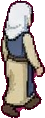 | mother ne 1 | 458, 213, 505, 333 | the mother walking away |
| 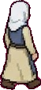 | mother ne 2 | 518, 213, 573, 329 | the mother walking away |
| 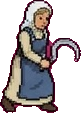 | mother reap 1 | 595, 216, 678, 332 | the mother harvesting barley |
| 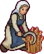 | mother reap 2 | 686, 221, 777, 332 | the mother harvesting barley |
| 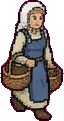 | mother basket se 1 | 803, 210, 869, 333 | the mother carrying a basket towards the viewer |
| 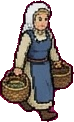 | mother basket se 2 | 909, 209, 985, 333 | the mother carrying a basket towards the viewer (drawn as "NE") |
|  | child se 1 | 1043, 235, 1089, 329 | the child walking towards the viewer |
|  | child se 2 | 1163, 232, 1212, 332 | the child walking towards the viewer (drawn as "NE") |
|  | sheep se 1 | 45, 415, 141, 499 | a sheep grazing and wandering |
|  | sheep se 2 | 167, 413, 260, 499 | a sheep grazing and wandering |
|  | sheep se 3 | 46, 582, 141, 662 | not used: another sheep pair |
|  | sheep se 4 | 179, 579, 274, 666 | not used: another sheep pair (labelled "NE", drawn side on) |
|  | ram 1 | 315, 397, 422, 498 | not used: horned rams nobody asked for |
|  | ram 2 | 445, 395, 556, 499 | not used: horned rams nobody asked for |
|  | deer se 1 | 327, 503, 475, 666 | the red deer stag in the forest |
|  | deer se 2 | 464, 519, 571, 665 | the red deer stag in the forest |
|  | deer se 3 | 608, 395, 713, 499 | not used: a third stag |
|  | deer se 4 | 616, 546, 711, 667 | not used: a fourth stag |
|  | raven black 1 | 1028, 398, 1109, 491 | not used: near-black, it converts as outline (the fixes sheet redrew it) |
|  | raven black 2 | 1132, 421, 1237, 484 | not used: near-black, it converts as outline (the fixes sheet redrew it) |
|  | knarr | 756, 391, 1013, 667 | the knarr that brings the family and newcomers |
|  | rowboat | 1051, 544, 1232, 663 | the fisher's rowing boat |
|  | goods logs | 99, 717, 211, 802 | the wood pile |
|  | goods planks | 244, 721, 351, 801 | the plank stack |
|  | goods stones | 382, 721, 483, 797 | the stone pile |
|  | goods firewood | 515, 721, 615, 801 | not used yet: firewood is wood in this version |
|  | goods grain | 653, 723, 719, 798 | the food store (grain) |
|  | goods fish | 763, 721, 841, 800 | the food store (fish) |
|  | goods wool | 880, 727, 960, 796 | not used yet: no wool in this version |
|  | goods iron | 997, 733, 1081, 787 | not used yet: no iron in this version |
|  | goods bread | 1121, 739, 1192, 784 | not used yet |

## The fixes: walks seen from behind, animals from behind, slate ravens, the stockfish rack, meadow, a small rock

`sheet_fixes.jpg`, 1264 x 848, from Gemini

| drawing | name | box | used for |
|---|---|---|---|
|  | father log ne 1 | 308, 32, 426, 199 | the father carrying a log away |
|  | father log ne 2 | 440, 33, 558, 205 | the father carrying a log away |
|  | father chop down | 38, 26, 266, 251 | not used: drawn on its own ground tile |
|  | mother ne 3 | 639, 40, 712, 205 | the mother walking away |
|  | mother ne 4 | 736, 39, 812, 198 | the mother walking away |
|  | mother basket ne | 901, 40, 987, 201 | the mother carrying a basket away |
|  | child ne 1 | 1065, 71, 1130, 200 | the child walking away |
|  | child ne 2 | 1155, 71, 1221, 203 | the child walking away |
|  | sheep ne 1 | 312, 374, 426, 493 | a sheep wandering away |
|  | sheep ne 2 | 458, 374, 574, 492 | a sheep wandering away |
|  | deer ne 1 | 623, 323, 752, 513 | the stag walking away |
|  | deer ne 2 | 793, 323, 922, 513 | the stag walking away |
|  | raven 1 | 1027, 397, 1110, 491 | ravens flying over |
|  | raven 2 | 1130, 420, 1238, 485 | ravens flying over |
|  | tile meadow | 605, 623, 886, 794 | the colour of the flower meadow |
|  | drying rack | 104, 511, 365, 795 | the stockfish drying rack |
|  | rock | 1078, 677, 1151, 740 | small rocks in the grass |
