# Space Mouse: reference art

The owner's art sheets, untouched, and every drawing cut from them at its original pixels (`frames/`), used in the game
or not. Made by `tools/art.py`, which also writes `ref.json` (the site's ART page reads it). Boxes are x0, y0, x1, y1 on
the sheet.

## The first sheet: station layouts, the mouse, cheese, props, tiles and decoration

`art_sheet.png`, 1536 x 1024, from ChatGPT

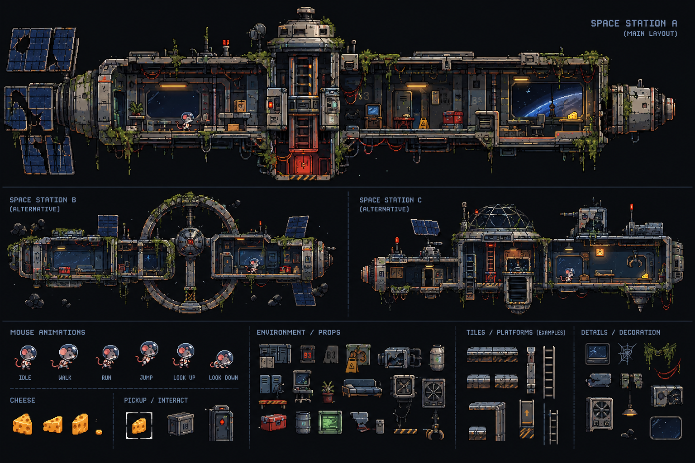

| drawing | name | box | used for |
|---|---|---|---|
|  | mouse idle | 28, 745, 85, 828 | Pip standing |
| 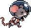 | mouse walk | 107, 745, 177, 828 | Pip walking (with run) |
|  | mouse run | 208, 745, 267, 828 | Pip walking (with walk) |
|  | mouse jump | 295, 745, 354, 828 | Pip in the air |
|  | mouse lookup | 377, 745, 434, 828 | Pip looking up, standing still |
|  | mouse lookdown | 461, 745, 520, 828 | Pip looking down (holding Down) |
| 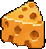 | cheese | 22, 900, 80, 972 | cheese crumbs |
| 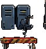 | prop lockers | 566, 820, 650, 904 | prop: map tile "k" |
| 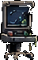 | prop terminal | 641, 815, 696, 894 | prop: map tile "m" |
| 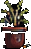 | prop plant | 709, 838, 745, 899 | prop: map tile "p" |
| 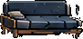 | prop sofa | 753, 833, 851, 897 | prop: map tile "h" |
| 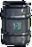 | prop barrel | 646, 905, 690, 965 | prop: map tile "o" |
| 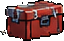 | prop toolbox | 567, 910, 638, 960 | prop: map tile "t" |
| 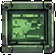 | prop wall screen | 698, 902, 761, 965 | prop: map tile "g" |
| 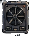 | prop fan box | 927, 832, 993, 908 | prop: map tile "f" |
| 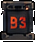 | prop B3 sign | 658, 757, 700, 808 | prop: map tile "b" |
| 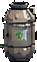 | prop gas tank | 946, 756, 990, 824 | prop: map tile "n" |
| 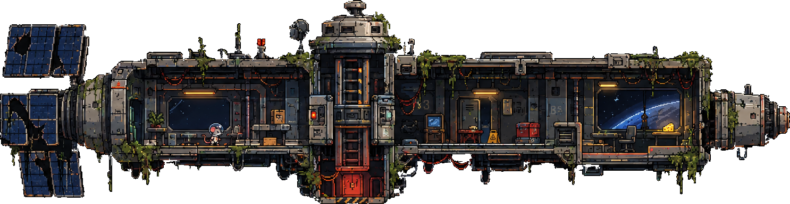 | station A | 0, 8, 1510, 408 | the station's look: layout A |
| 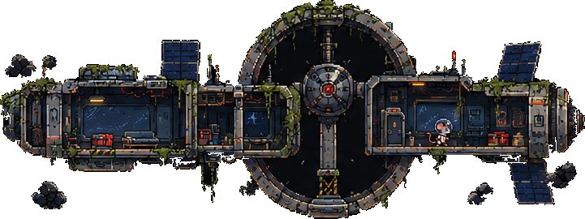 | station B | 10, 425, 762, 703 | the station's look: layout B |
| 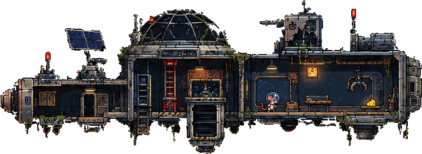 | station C | 778, 425, 1530, 703 | the station's look: layout C |
| 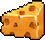 | cheese 2 | 88, 913, 145, 965 | not used yet |
|  | cheese 3 | 152, 907, 202, 969 | not used yet |
|  | crumb | 204, 943, 233, 969 | not used yet |
| 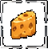 | cheese pickup | 272, 905, 344, 978 | not used yet |
| 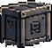 | crate | 364, 905, 435, 971 | not used yet |
| 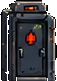 | door with red light | 447, 889, 523, 982 | not used yet |
| 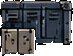 | wall cabinet | 566, 754, 651, 822 | not used yet |
| 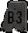 | B3 sign grey | 707, 757, 755, 811 | not used yet |
| 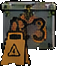 | B3 warning sign | 757, 753, 826, 831 | not used yet |
| 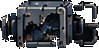 | broken machine | 827, 761, 938, 822 | not used yet |
| 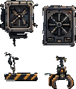 | vent panel and claw | 856, 824, 990, 980 | not used yet |
| 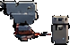 | little robot | 767, 904, 857, 967 | not used yet |
| 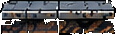 | platform long | 1024, 761, 1152, 808 | not used yet |
| 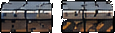 | platforms short | 1025, 821, 1152, 866 | not used yet |
| 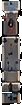 | post | 1157, 761, 1191, 878 | not used yet |
| 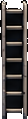 | ladder tall | 1193, 758, 1233, 889 | not used yet: needs climbing |
| 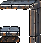 | wall corner | 1029, 882, 1124, 982 | not used yet |
| 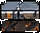 | block | 1029, 936, 1081, 981 | not used yet |
| 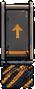 | lift door | 1141, 876, 1188, 977 | not used yet |
| 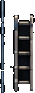 | ladder short | 1194, 886, 1241, 991 | not used yet: needs climbing |
| 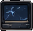 | monitor | 1288, 751, 1355, 814 | not used yet |
| 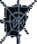 | cobweb | 1360, 752, 1413, 813 | drawn by decor.js instead (cobwebs) |
| 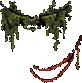 | moss and red cable | 1417, 751, 1511, 845 | drawn by decor.js instead (moss strands, cable loops) |
| 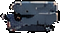 | vent box | 1287, 819, 1359, 864 | not used yet |
| 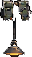 | hanging lamp | 1362, 818, 1428, 928 | not used yet |
| 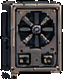 | fan unit | 1287, 871, 1362, 964 | not used yet |
| 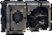 | broken panel | 1430, 845, 1516, 907 | not used yet |
| 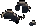 | rubble | 1365, 941, 1408, 977 | not used yet |
| 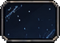 | window | 1428, 914, 1515, 980 | the windows are drawn from the map (:) |

## More of Pip's moves: wall slide, falling, landing, eating, zapped, victory

`mouse_actions_sheet.jpg`, 1264 x 843, from Gemini

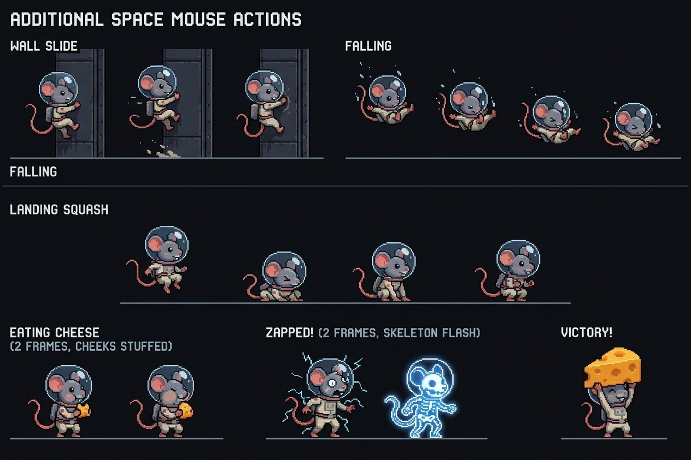

| drawing | name | box | used for |
|---|---|---|---|
| 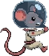 | mouse wall1 | 30, 105, 160, 286 | Pip sliding down a wall |
| 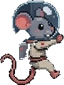 | mouse wall2 | 420, 105, 532, 286 | Pip sliding down a wall |
| 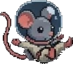 | mouse fall1 | 640, 118, 766, 238 | Pip tumbling on a long fall |
| 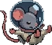 | mouse fall2 | 786, 138, 916, 250 | Pip tumbling on a long fall |
| 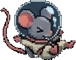 | mouse fall3 | 938, 164, 1072, 272 | Pip tumbling on a long fall |
|  | mouse fall4 | 1090, 176, 1216, 285 | Pip tumbling on a long fall |
| 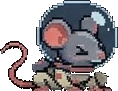 | mouse land1 | 440, 403, 565, 551 | Pip after a hard landing (squash) |
|  | mouse land2 | 640, 403, 765, 551 | Pip after a hard landing (getting up) |
|  | mouse eat1 | 12, 650, 180, 799 | Pip chewing |
|  | mouse eat2 | 222, 650, 372, 799 | Pip chewing |
|  | mouse zap1 | 505, 638, 690, 799 | Pip zapped by a cable |
|  | mouse zap2 | 695, 638, 850, 799 | Pip zapped: the skeleton flash |
|  | mouse win | 1050, 628, 1190, 799 | Pip clearing a sector |
|  | mouse wall slide middle | 250, 105, 345, 286 | not used yet (the two others are) |
|  | mouse landing in the air | 218, 403, 354, 551 | not used yet |
|  | mouse landing standing | 860, 403, 995, 551 | not used yet |

## The cat-bot: patrol walk, alert, chase run, shorted out

`catbot_sheet.png`, 1536 x 1024, from ChatGPT

| drawing | name | box | used for |
|---|---|---|---|
|  | cat walk1 | 200, 62, 440, 230 | cat-bot on patrol |
|  | cat walk2 | 500, 62, 735, 230 | cat-bot on patrol |
|  | cat walk3 | 790, 62, 1040, 232 | cat-bot on patrol |
|  | cat walk4 | 1092, 60, 1348, 230 | cat-bot on patrol |
|  | cat alert1 | 495, 292, 698, 470 | cat-bot spotting the mouse |
|  | cat alert2 | 806, 292, 1000, 470 | cat-bot spotting the mouse |
|  | cat run1 | 110, 535, 382, 686 | cat-bot chasing |
|  | cat run2 | 444, 535, 714, 676 | cat-bot chasing |
|  | cat run3 | 782, 535, 1060, 688 | cat-bot chasing |
|  | cat run4 | 1138, 540, 1407, 686 | cat-bot chasing |
|  | cat down1 | 470, 736, 703, 924 | shorted cat-bot, sparking |
|  | cat down2 | 766, 760, 1046, 926 | shorted cat-bot, the wreck |

## Objects: checkpoint, the great cheese, lamps, alarm beacon, hatches, ladder, lift

`objects_sheet.jpg`, 1264 x 843, from Gemini

| drawing | name | box | used for |
|---|---|---|---|
|  | check off | 60, 30, 200, 320 | checkpoint, not reached yet |
|  | check on | 240, 22, 410, 320 | checkpoint, reached |
|  | goal | 495, 36, 770, 330 | the great cheese (the goal) |
|  | lamp off | 36, 412, 290, 476 | ceiling lamp, off |
|  | lamp on | 328, 400, 592, 474 | ceiling lamp, on |
|  | alarm1 | 730, 388, 862, 546 | alarm beacon, turning |
|  | alarm2 | 1025, 388, 1156, 546 | alarm beacon, turning |
|  | prop hatch | 40, 610, 244, 816 | prop: map tile "d" |
|  | prop open hatch | 546, 610, 750, 816 | prop: map tile "e" |
|  | lamp off 2 | 944, 64, 1202, 122 | not used: the same lamp drawn again |
|  | lamp on 2 | 942, 180, 1202, 290 | not used: the same lamp drawn again |
|  | hatch half open | 291, 613, 494, 816 | not used yet: a door that opens needs a switch or a key |
|  | ladder | 853, 613, 929, 824 | not used yet: needs climbing |
|  | lift | 990, 606, 1206, 822 | not used yet: needs moving platforms |
