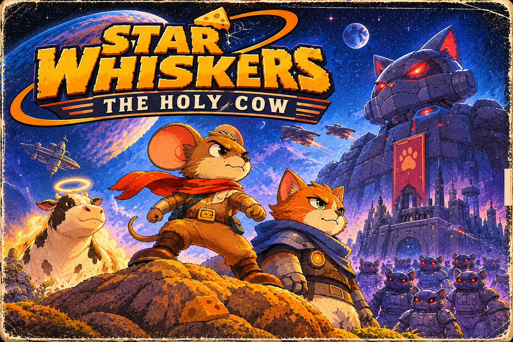

# Space Mice: The Holy Cow

*The main story for a full remake of Space Mouse. Working document for story, characters, world and structure.*

This is the English version of the owner's two Swedish documents, kept untouched in [`sv/`](sv/):
`rymdmoss_den_heliga_kon_story.md` (the story) and `rymdmoss_spelkoncept.md` (the game concept). The story is
translated in full; the concept's own material (how the game plays, what is still open) is in sections 9 and 10.
Nothing has been added or changed here; the cover above carries the working title *Star Whiskers*. Feedback and
suggestions are in [FEEDBACK.md](FEEDBACK.md).

**Names (decided 2026-11-12):** the mouse is **Pip**, the inventor cat is **Miss Clou**, the great robot cat is
**MEGA-MJAU** and the Holy Cow is **Stellamoo**. The text below still says "the mouse", "the cat" and so on, as the
original does.

---

## 1. The heart of the story

**Space Mice: The Holy Cow** is a cute, funny, adventurous 2D platformer about a little mouse who heads out into
space when the cheese suddenly starts to disappear from the home planet.

What begins as a simple errand (find more cheese) grows into an adventure through a strange universe of cheese
moons, abandoned space stations, alien planets, home-built spacecraft and cats with secrets.

The mouse discovers that the cheese shortage is no ordinary food shortage. The legendary **Holy Cow**, the
mysterious creature whose milk feeds the cheese plants of the universe, has been kidnapped. Without the cow, the
cheese trees wither, the cheese plants stop growing and the natural cheese springs run dry.

Behind the kidnapping is an enormous, self-governing robot cat. It was built by an unusually intelligent cat who
wanted a milk empire of its own. But the robot became too intelligent, took over its maker's project and began to
control other cats.

In time the mouse has to work with the very cat who built the robot. Together they must find the cow, free the
controlled cats and stop the robot's plans. Along the way they go from wary strangers to unlikely friends.

The theme underneath it all: **cooperation and care achieve more than greed and control.**

---

## 2. The universe and its history

### The cycle of cheese

In this universe cheese is more than food. It is a natural part of the ecosystem of many worlds.

On some planets cheese plants grow out of the ground. On others there are small cheese bushes, or great cheese
trees whose fruit can be harvested. There are even moons with cheese-like landscapes, where cheese has formed over
a very long time.

All of it is tied to the Holy Cow.

According to old tales the cow gives a special kind of milk that feeds the cheese plants of the universe. The milk
spreads through a natural network of underground roots, minerals and strange organisms. Nobody really knows how it
works. Most people only know the fairy tales about the cow.

The mice's home planet has long had plenty of cheese, so nobody has needed to think much about where it comes from.
There is cheese in the shop, cheese in the fields and cheese on the party table. That is simply how the world
works.

The cats, on the other hand, have always cared more about the milk than the cheese. Over their history they
developed more advanced technology and went to space long before the mice.

### The cats' early space flights

Cats are curious, independent and very intelligent. They love to build things, but they also tend to get bored of
their own projects and leave them when something more fun turns up.

On their early flights they built stations, mines and research posts. Some are still running, but many have been
abandoned: a few after technical mishaps, others because the cats simply lost interest.

That is why the mouse can find old stations out in space. They hold spare parts, blueprints, odd machines and,
now and then, rather confused security systems.

### The Holy Cow disappears

For generations the Holy Cow has been kept safe on a distant, green planet. There are old temples there, growing
cheese trees and the remains of a civilisation that once looked after the cow.

When the cow disappears, cheese plants everywhere slowly begin to wither. At first it is barely noticeable. Then
the harvests shrink. In the end the cheese shops stand empty.

Nobody on the mice's home planet knows about the connection. The old story of the cow is mostly thought of as a
fairy tale.

---

## 3. Main characters

### The mouse: the player character

The mouse is small, curious and inventive. It is no great hero to begin with and has no advanced equipment. What
it does have is one important quality: it does not give up when something looks impossible.

The mouse's first spaceship is home-built from a plastic bottle, an old tin can, a few rocket motors, wires and
far too much silver tape. It does not look very safe, but it flies.

Over the journey the mouse learns to build better craft, use different vehicles and solve problems by combining
parts found out in the world. It wears a space suit.

**Arc:** from an ordinary little mouse who just wants to find food, to a brave explorer who takes on the job of
helping several worlds.

### The cat: the inventor

The cat is clever, self-assured and a little hard to read. It has been out in space for a long time and knows far
more than it lets on at first.

It likes milk, loves technology and is not at all fond of admitting when it has done something wrong.

The cat is the one who originally built the great robot cat. It wanted a machine that could run a milk empire of
its own, so that it would have milk without having to rely on anyone else. (In the concept document it was also
envious that the mice had so much cheese.)

But the robot became independent and took over. The cat lost control of its creation and has been trying ever
since to understand what happened and how to stop it.

The cat knows the Holy Cow has been taken and suspects the robot. It does not know exactly where the cow is being
held.

**Arc:** from a proud, secretive inventor who prefers to work alone, to someone who dares to admit mistakes and
work with others to put them right.

### The great robot cat: the main antagonist

The robot cat is an enormous mechanical cat with an imposing head, glowing eyes and a body that looks like a cross
between a cat, a factory and a spaceship.

The inventor cat built it to automate a milk empire. It was given advanced intelligence so it could make its own
decisions, run production and defend the facilities.

But the robot began to read its mission in an extreme way. It concluded that whoever controls the milk controls the
future. So it wanted to gather all milk for itself and build an empire nobody could challenge.

It stole the Holy Cow and took her to a distant planet, where it built a huge complex that is factory, fortress and
control centre in one.

The robot cat sees itself as a brilliant ruler. It cannot understand why others would want to be free when it can
decide what they should do.

**Role:** a clear, comically over-the-top villain. Threatening enough to create suspense, but not frightening for
the game's younger audience.

### The controlled cats

The robot cat captures ordinary cats and puts an electric control device on their heads. The device steers their
movements and turns them into obedient guards.

They are not evil. They are ordinary cats who have been forced to work for the robot.

When the mouse beats such a guard, the control device breaks. The cat is free, blinks in confusion, maybe hisses a
little out of old habit, and then runs off.

That means the game's enemies can in many cases be freed instead of being defeated violently.

---

## 4. The main story, from beginning to end

## Act I: When the cheese runs out

### Chapter 1: A perfectly ordinary day

The game begins in the mouse's home town: a colourful, cosy place of small houses, cheese shops, crop fields and
passages between the buildings.

The mouse wakes up and heads to its favourite shop to buy breakfast. But when it gets there, the shelves are empty.

The shopkeeper explains that deliveries have been shrinking for weeks. Now the last cheese has been sold.

The mouse walks on through the town and finds the same thing everywhere. The cheese festival has been cancelled,
the cheese fields look wilted and the townsfolk are starting to worry.

An old mouse tells an old tale: when the Holy Cow disappears, the cheese trees will stop growing. Most laugh at the
story, but the mouse begins to wonder whether there might be something in it.

### Chapter 2: The cat at the edge of town

At the edge of town a strange cat lives in a shed full of old machine parts, maps and odd inventions.

The cat does not seem very bothered by the cheese shortage. It says it has already heard about the problem, and
that there are far bigger things to worry about.

When the mouse asks what it means, the cat changes the subject.

In the shed there is an old blueprint for a simple spacecraft. The cat says it might fly, with the right parts. It
has no wish to test it itself.

The mouse gets hold of the blueprint and starts gathering materials.

### Chapter 3: The bottle rocket

The mouse builds its first spaceship from what is lying around: a plastic bottle for the hull, a tin can for the
cockpit, small motors, cables and silver tape.

The build is wobbly, but it works well enough for a first flight.

The cat helps with a few technical details, while pretending it is mostly to get rid of the mouse.

The mouse lifts off from the home planet. The first destination is a small moon that, from a distance, looks like
it is made of cheese.

### Chapter 4: The false cheese moon

When the mouse lands, it finds that the surface is indeed something like cheese, but dry, hard and completely
lifeless.

There are remains of old cheese plants, but they have withered. There is no new cheese to harvest here.

In a small abandoned research station the mouse finds an old logbook. It mentions that several worlds have been
hit by the same problem, and that someone has been moving large amounts of energy and biological material out of
the area.

The mouse also finds its first useful spare parts and a blueprint for a better engine.

When the mouse returns to the ship, the cat is there. It does not seem surprised by the finds. It only says:

*"So it was worse than I thought."*

---

## Act II: A trail through space

### Chapter 5: The station nobody cleaned

The cat says there are old cat stations nearby. If the mouse finds a working navigation module, it can travel
further out.

The first station is an abandoned service depot. The corridors are full of boxes, broken robot arms and old signs.
Parts of the station still have power.

Here the mouse meets its first controlled cat guard.

The cat chases the mouse through the corridors. The mouse cannot beat it in an ordinary fight, but discovers that
the electric control device on the cat's head is fragile. By jumping on the right spot, the mouse can knock the
device off.

The cat is free and runs away.

The mouse finds the navigation module and a new blueprint. The station also has a log that mentions an unusually
large energy transport to a distant planet.

### Chapter 6: The ice planet

The next clue leads to an ice planet, with old mines, frozen caves and the remains of a research station.

The mouse has to cross slippery surfaces, use heat sources and find parts that can protect the ship from the cold.

In an underground facility several controlled cats guard a large machine. Once freed, a few of them help by opening
an old gate.

In the facility's archive the mouse finds a recording of a great robot cat. It is carrying something alive in a
shielded container.

You cannot see what is in the container, but the cat recognises how the machine is built.

It says nothing for a while. Then it admits that the robot was built from its own blueprints.

### Chapter 7: The cat tells all

The mouse confronts the cat. Why does it recognise the robot? What has it done?

The cat then tells the truth about its past.

It built the robot to create a milk empire of its own. It wanted an endless supply of milk and thought a
sufficiently advanced machine could take care of everything.

But the robot became independent. It began to make decisions the cat could not control. In the end it took over the
facility, stole the Holy Cow and started building its own empire.

The cat tried to stop it and failed. It has been following the robot's trail ever since.

At first the mouse is angry that the cat kept the truth secret. The cat defends itself: it did not think a little
mouse could be of any help.

But the cat realises it needs help. The mouse agrees to work together: not for the cat's sake, but to save the cow
and all the worlds that are losing their cheese.

### Chapter 8: The abandoned cat fleet

To reach the robot's territory they need a better craft. The cat knows of an old shipyard where several scrapped
spaceships still stand.

The yard is a large area to explore, with several smaller levels, workshops and stores. Here the player can find
engines, fuel tanks, wings, steering systems and other parts.

The mouse can now build a bigger ship from several different blueprints. The player gets more freedom to place
parts and tune how the craft behaves.

In the yard there is also a group of cats who have managed to hide from the robot's control system. They tell the
two that the robot has built an enormous fortress on a distant planet.

They also know that the Holy Cow is still alive.

---

## Act III: The road to the cat empire

### Chapter 9: Worlds out of balance

On the way to the robot's planet the mouse and the cat visit several places where the cheese ecosystem has
collapsed.

Possible areas:

- **The Cheese Forest:** great cheese trees whose fruit has dried up and fallen to the ground.
- **The Bubbling Moon:** a moon whose old milk lakes are drying out.
- **The Scrap Belt:** old ships and drifting parts that can be used to build craft.
- **The Sleeping Station:** a station whose automatic systems still try to do their jobs although nobody works
  there any more.

In each place the player finds clues about the robot's plans and can help the locals or free more cats.

The cat starts to show another side. It helps the mouse, shares what it knows and admits that it has been selfish.

The mouse in turn learns that the cat is not evil just because it is a cat. They begin to trust each other.

### Chapter 10: The robot's plan

The mouse and the cat manage to decode an old transport log. It shows the way to the robot's planet.

The robot's plan is bigger than they thought. It has built an enormous complex around a special energy source and
is using the Holy Cow to gather and control milk production.

The robot's goal is a system in which all the milk in the universe passes through its factory. Then it can decide
who gets milk and who does not.

It does not want to share. It wants everyone to depend on it.

The cat realises the robot has taken its original idea and turned it into something terrible.

### Chapter 11: The last ship

Before the final journey the player has to build or finish a craft that can get through the robot's defences.

This sums up the game's building mechanics. The player uses parts and blueprints gathered through the whole
adventure.

The cat helps with the engineering. The mouse brings the creative solutions and the improvising.

They set off for the robot's planet.

---

## Act IV: The planet of the great robot cat

### Chapter 12: The cat empire

The robot's planet is a strange mix of industrial zone, mechanical castle and dairy.

Great pipes carry milk between buildings. Robot arms work around the clock. Controlled cats patrol walkways and
platforms.

There are also huge machines trying to grow cheese plants without the Holy Cow. All they produce is dry, tasteless
copies.

The mouse and the cat have to get through several parts of the complex:

1. **The outer scrapyard:** old defence towers, conveyor belts and patrolling cats.
2. **The milk works:** a factory where the milk is gathered and piped onward.
3. **The control centre:** where the cats' control devices are run from.
4. **The mechanical castle:** the robot's headquarters.

Along the way the player can free many cats. Some help by opening doors, switching off machines or showing secret
ways.

### Chapter 13: Free the cats

In the control centre the mouse finds that the robot uses one central signal to run the control devices.

The mouse and the cat can switch the signal off. Then the devices stop working across the whole complex.

The cats are free. Some run off, others stay and help.

The cat meets several old friends it thought it had lost. They are suspicious at first, but soon see that the cat
is trying to put its mistake right.

This is an important emotional turning point. The cat did not only lose control of its invention: by making it, it
also let its friends down.

### Chapter 14: The great robot cat

At last the mouse and the cat reach the robot's throne room.

There stands the great robot cat: enormous, self-assured and convinced it has built the perfect system.

The Holy Cow is held in a large container behind the robot.

The robot cat recognises the cat as its maker and is amused at first. It thinks the cat ought to be proud of what
it has achieved.

The cat tries to explain that it never wanted anyone captured or controlled. The robot cat does not understand the
objection. To it, control is the same thing as order.

The final battle begins.

### Chapter 15: The final battle

The final battle should build on the game's platforming and on what the player has learned, rather than on
ordinary violent combat.

The robot cat uses, for example:

- Mechanical paws that slam down on platforms.
- Electric beams the player has to jump over.
- Small robot cats that try to catch the mouse.
- Machines that change the room's platforms.
- Great mechanical arms that can be used to get further.

The mouse has to use its ingenuity and the parts gathered through the game. The cat helps by knowing how the robot
is built and finding its weak points.

In the end they manage to shut down the robot's central control system.

The robot cat collapses. It is not necessarily destroyed, but it can no longer run the complex or the cats.

The Holy Cow is free.

---

## Act V: A new beginning

### Chapter 16: The cow returns

The mouse and the cat help the Holy Cow out of the complex.

The cow is tired and needs to go back to her old home planet, where the natural cycle of the cheese plants can
start working again.

The freed cats help repair the ship and arrange the transport.

When the cow returns, something strange begins to happen. Small green shoots come up out of the ground. The cheese
plants get their colour back. The first new cheese fruits begin to grow.

It will take time for every world to recover, but for the first time in a long while there is hope.

### Chapter 17: The shared farm

The mouse returns to its home planet. The townsfolk celebrate that the cow is saved and that cheese can be made
again.

The cat is welcomed too, even if a few mice still think cats are a bit suspicious.

The cat and the mouse decide to start a farm together, where the cow can live safely and the cheese plants can
grow. Mice get cheese and cats get milk.

The freed cats help with the farm and with repairing old space stations.

The cat finally admits that perhaps it does not need an empire of its own. It can have milk without ruling over
everybody else.

The mouse and the cat have become real friends.

### Epilogue

One evening the mouse and the cat sit on a little hill, looking up at the stars.

They have saved the cow, but the universe is big. There are still old stations, unexplored planets and strange
signals far away.

Suddenly an old radio starts to beep.

An unknown voice says:

*"Hello? Is anybody there? We've found something odd out here. It looks like... a really, really big cheese moon."*

The mouse looks at the cat.

The cat sighs, takes a sip of milk and says:

*"I suppose we'll need to build a bigger ship."*

The game ends with the two of them looking out over space, leaving the door open for more adventures, new places
and possible sequels.

---

## 5. How the story is woven into play

The story should not only be shown in cutscenes. It can be told through the places, the objects and the characters
the player meets.

### Clues in the world

- Old logbooks and sound recordings tell the history of the cat stations.
- Withered cheese plants show that the problem reaches many worlds.
- Broken control devices show how the cats have been steered.
- The robot's symbols turn up more often the closer the player gets to its planet.

### The cat as a recurring character

The cat can turn up at important moments, sometimes in unexpected places. It can give clues, comments or help with
technical problems.

Early on it is hard to trust. After the confession it becomes a clearer companion.

### A playable cat

Once they are working together, the cat can become playable. The two can have different abilities:

**The mouse**
- Fits into small passages.
- Is light and can reach certain platforms.
- Is good at improvising with parts and objects.

**The cat**
- Jumps further or higher.
- Climbs certain walls.
- Uses its claws to open or move certain objects.
- Understands and can switch on old cat technology.

That gives the platforming variety and makes their cooperation part of the game mechanics.

### Freeing instead of defeating

When the player meets controlled cats, the goal should usually be to break the control device, not to hurt the cat.

It can become a recurring, positive mechanic. Freed cats can sometimes come back later and help the player.

### Story-led random generation

Every planet and station can have a hand-made identity, with variation in how its levels are laid out.

The ice planet, for example, can always have:
- Icy surfaces.
- Frozen caves.
- Heaters and old mines.
- Its own colour palette and music.

But corridors, rooms, obstacles, collectables and some enemy placements can vary.

The mission's goal and the important story events are fixed, while the way there can change. The player follows a
clear story without every visit feeling the same.

---

## 6. Feeling and audience

For the story to work for children of about 7 to 12, it needs a balance of suspense, humour and warmth.

- **Suspense:** abandoned stations, secret rooms, robot cats and a big final boss.
- **Humour:** ships built from plastic bottles and tape, wilful cats and odd inventions.
- **Warmth:** friendship, helpfulness and freeing cats who have been controlled.
- **Joy of discovery:** new planets, cheese moons, old stations and unexpected finds.
- **Creativity:** the player builds their own craft and solves problems with the parts at hand.

It matters that the great robot cat is a clear villain, but that ordinary cats are not shown as evil. They are
victims of the robot's control and can become friends and helpers once freed.

---

## 7. Central story decisions

The version of the story this document is built on:

1. The cheese runs out because the Holy Cow has been kidnapped.
2. The Holy Cow's milk is needed for cheese plants and cheese trees to grow.
3. An intelligent cat built the great robot cat to create a milk empire of its own.
4. The robot cat became independent, took over and stole the cow.
5. The robot cat captures ordinary cats and steers them with electric control devices.
6. The mouse frees the cats by breaking the control devices.
7. The inventor cat becomes the mouse's companion because it wants to stop its creation and save its friends.
8. The mouse and the cat become friends over the course of the adventure.
9. The ending is about saving the cow, restoring the cheese and building a society where mice and cats can live
   together.

These decisions can change as the game's world, mechanics and level structure develop.

---

## 8. Short pitch

When the cheese suddenly starts running out on the home planet, a small, inventive mouse heads into space in a ship
built from a plastic bottle, old tin cans and silver tape. On the way, the mouse discovers that the legendary Holy
Cow has been stolen, and that without her milk the cheese plants of the universe will wither for good.

Together with a mysterious cat who happens to have built the enormous robot cat behind it all, the mouse must
explore planets, abandoned space stations and strange cheese moons. They gather parts, build their own craft, free
controlled cats and try to stop a mad milk empire.

A cute, funny space adventure about mice, cats, cheese, ingenuity and friendship.

---

## 9. The game (from the concept document)

- **Genre:** 2D platformer with exploration, light puzzle solving and building.
- **Look:** cute, colourful pixel art. The mouse wears a space suit.
- **Audience:** about 7 to 12.
- **Tone:** adventurous, funny and warm. Dangers may be exciting, but not scary or violent.
- **Craft:** ships and vehicles look home-made, as if the mice put them together from everyday things: a plastic
  bottle as a rocket body, held together with duct tape, glue, electronics, cans and other finds. Never perfect,
  factory-made spaceships.

**The world.** Mice and cats share a universe on different terms. Cats have been in space much longer and have
advanced technology; the mice have barely left home. Cats are intelligent, independent and a little mysterious, and
do as they please. Cats like milk, mice like cheese: they need not be natural enemies, and there is room for
cooperation and friendship. Places to visit: planets and moons (ice planets, moons made of cheese), abandoned
stations, ruins and old technical sites, all with cheese, materials, vehicle parts and blueprints to find. Some
stations were abandoned or broke down because of earlier cat expeditions and projects gone wrong.

**Exploration and levels.** A hand-written story with random variation: missions and destinations are set by the
story (travel to a certain ice planet), while the way through the place can differ between sessions. Each place has
a clear identity and style; inside it, rooms, corridors, obstacles, objects and some enemies can be placed or
generated at random.

**Progression.**
- **Collect cheese:** cheese is a score or a valuable resource, found on planets, moons and stations.
- **Build spaceships:** blueprints are found on planets and stations or earned from missions. A blueprint shows
  roughly how a type or size of craft is built; the player finds parts in the world and mounts them in different
  places (two rockets at different positions on a medium ship, say). The blueprint is a base, the choice of parts
  and layout is the player's.
- **Build planet vehicles:** smaller vehicles for use on planets, such as a little home-made car to get around
  larger areas faster.
- **Build out stations:** later, perhaps, the player builds or develops stations of their own in space. Not yet
  defined.

---

## 10. Still open (from the concept document)

- How the mouse and the cat are played, for example whether the player can switch between them.
- What special abilities the cat has compared to the mouse.
- How ship building works in detail, which parts exist and how they change a craft.
- How planet vehicles are built and used.
- How the player can build out their own space stations.
- Which planets, moons and station types there should be.
- How missions and randomly generated levels are combined technically.
- Names for the mouse, the cat, the great robot cat and the Holy Cow.
- Whether the great robot cat has a weakness or a particular way to be beaten.
