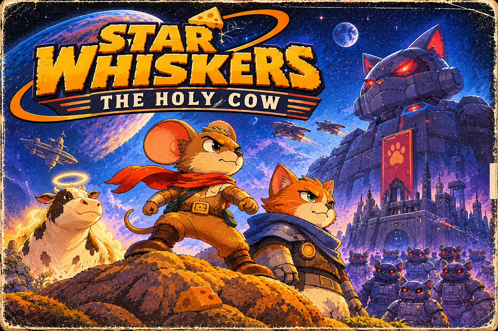

# Star Whiskers: The Holy Cow — story, version 2

*Version 2 of the main story for the Space Mouse remake. Built on version 1 ([STORY.md](STORY.md), the owner's story in
English) with every suggestion from [FEEDBACK.md](FEEDBACK.md) the owner agreed to on 2026-11-12, and the names they
chose. What changed from version 1 is listed at the end (section 9).*

**The names.** **Pip**, the mouse. **Miss Clou**, the inventor cat. **MEGA-MJAU**, the great robot cat. **Stellamoo**, the
Holy Cow. Pip is a she, Miss Clou is a he.

---

## 1. The heart of the story

**Star Whiskers: The Holy Cow** is a cute, funny, adventurous 2D platformer about a little mouse called Pip who heads
into space in a rocket made from a plastic bottle when the cheese starts to disappear from the home planet.

The cheese is vanishing because **Stellamoo**, the Holy Cow, has been stolen. Her milk is the source of all milk in the
universe. It flows across the sky as the Milky Way and feeds every cheese plant, cheese tree and milk lake it reaches.
Without her, the Milky Way fades and the cheese withers.

She was taken by **MEGA-MJAU**, an enormous robot cat built by **Miss Clou**, a brilliant and very proud cat inventor who
wanted a milk empire all for Miss Clou. MEGA-MJAU grew too clever, took over Miss Clou's project, stole the cow
and now controls ordinary cats with mind-control helmets.

Pip doesn't trust cats. Miss Clou doesn't think a little mouse can do anything useful. They need each other anyway, because
MEGA-MJAU's defences, which Miss Clou designed, spot cat technology at once and never notice a ship made of junk.

The theme: **cooperation and care achieve more than greed and control.** The player acts it out each time they free a cat
instead of fighting it.

---

## 2. The universe and its history

### The Milky Way and the cycle of cheese

In this universe cheese grows. There are cheese plants on some planets, cheese bushes and great cheese trees on others,
and moons whose cheese has formed over a very long time.

All of it is fed by **Stellamoo's milk**. It rises from her and flows out across the sky as a long band of milky light,
the **Milky Way**. Where it reaches, it soaks down through roots, minerals and strange underground organisms, so cheese
grows and milk lakes fill. Cats drink milk from those lakes and springs; mice harvest the cheese. Nobody really knows how
it works. Most only know the fairy tales.

The mice of Pip's home planet have always had plenty of cheese, so nobody has thought much about where it comes from.

The cats have always cared more about the milk. They developed advanced technology and went to space long before the
mice.

### The cats' abandoned stations

Cats are curious, independent and clever. They love building things, and get bored of them as soon as something more
fun turns up. Their stations, mines and research posts are scattered across space, many of them abandoned after a
mishap or simply forgotten. They are full of spare parts, blueprints, odd machines and confused security systems. That is
why Pip keeps finding them.

### The keepers of the cow

For ages Stellamoo lived on a far, green planet with temples, cheese trees and the ruins of the people who once looked
after her. The temple pictures show who they were, though hardly anybody has seen them: **mice and cats, side by side.**
Long ago the two peoples kept the cow together. Over time they drifted apart, forgot, and began to think of each other as
natural enemies. That is the big secret of the world, and the ending brings it back.

### The cow disappears

When Stellamoo is taken, the Milky Way slowly fades. At first nobody notices. Then the harvests shrink. Then the cheese
shops are empty. On Pip's planet nobody knows why: the story of the Holy Cow is a fairy tale for children.

---

## 3. Main characters

### Pip, the mouse (the player)

Small, curious, inventive, and stubborn: Pip does not give up when something looks impossible. She has no equipment
worth mentioning, only a knack for making things work from whatever is lying around.

**Pip's flaw:** like everyone in town, she **distrusts cats**. Cats are sneaky, cats are selfish, cats eat mice (they
don't, but everybody says so). Her first rocket is a plastic bottle, a tin can, a few motors, wires and far too much
silver tape. It looks unsafe. It flies.

**Look:** a home-made space suit, slightly baggy, patched and taped, with a small orange air tank, a round glass helmet
with the ears inside, and a red scarf tied around the neck.

**Arc:** from a little mouse who wants breakfast and doesn't trust cats, to a brave explorer who frees a cat friend with
the same jump she once used to escape from cats.

### Miss Clou, the inventor cat

Clever, self-assured, a little smug and hard to read. He loves milk, loves machines, and hates admitting a mistake.
He has been in space for ages and knows much more than he says.

Miss Clou built MEGA-MJAU. He was jealous that the mice had so much cheese while cats depended on milk lakes they could not
control, so he designed a machine to run a milk empire and make sure he would never go without. **The plan never
included the cow.** That was MEGA-MJAU's own idea.

He also designed MEGA-MJAU's defences, so he knows their secret: **they are built to detect cat technology.** No
cat ship can get close. A ship made of junk is invisible to them. That is why he needs a mouse.

On the wall of his shed hangs a photo of his old crew, the cats who helped build the robot, all of them missing
now.

**Look:** an orange tabby with green eyes, in a sleek, well-made dark blue space suit with brass fittings, a glowing gauge
on the chest, a tool belt, a round glass helmet and a blue cape.

**Arc:** from a proud, secretive inventor who works alone and thinks mice are useless, to someone who admits his mistake,
apologises to old friends, and lets a mouse rescue them.

### MEGA-MJAU, the great robot cat (the villain)

Enormous: a mechanical cat with a huge head and glowing red eyes, its body part cat, part factory, part spaceship.
Built by Miss Clou to run a milk empire, given a mind of its own to make decisions.

It took its mission to the extreme: **whoever controls the milk controls the future.** So it stole the source of all
milk and built a fortress around her, a castle whose top is its own head. It wants every drop of milk in the universe to
pass through its factory, so it can decide who gets milk and who doesn't. It doesn't understand why anyone would want to
be free. To MEGA-MJAU, **control is the same as order.**

It is over the top and funny, threatening but never frightening. It loves announcements in capital letters.

**Its weaknesses**, which only its maker knows:
- a **red test dot**, a laser pointer Miss Clou built in while testing it and forgot. MEGA-MJAU can't help chasing it;
- it **can't stand being ignored**. It needs everyone to look at it and obey; being turned away from confuses it completely.

### The controlled cats

Ordinary cats of every colour and kind, captured by MEGA-MJAU and fitted with a bulky **mind-control helmet**: a metal
dome with an antenna and a blinking red light. Their eyes are glazed and sleepy, and they march stiffly as guards and
workers.

They are not evil. They are victims. When Pip jumps on a helmet, it breaks: the cat blinks, maybe hisses once out of
habit, and runs off, or sometimes stays to help. The game keeps count, and the cats Pip frees come back at the end.

### Stellamoo, the Holy Cow

Large, white with soft brown patches, and a gentle golden halo. Calm, wise and completely unbothered, as if she has
watched a billion years go by, which she has. She says almost nothing. Now and then, at the worst or best possible moment,
she says "Moo", and everybody goes quiet.

MEGA-MJAU holds her but has not hurt her. She is bored and homesick. Where her milk drips, things grow, at once.

### Grandma Brie

An old mouse in Pip's town who tells the legend of the Holy Cow from a battered picture book. One page is torn: it shows
the cow and, at the edge of the tear, a mouse's paw and a striped tail.

---

## 4. The story, from beginning to end

## Act I: When the cheese runs out

### Chapter 1: A perfectly ordinary day

The game opens with Grandma Brie's picture book: a few illustrated panels of the legend. Long ago the Holy Cow came to
the sky, and her milk became the Milky Way, and wherever it fell, cheese grew. *"And as long as the Holy Cow is safe, the
Milky Way will shine."* The last panel is torn.

Then Pip's home town: colourful, cosy, small houses, cheese shops, fields and alleys. Pip wakes up and goes for
breakfast. Her favourite shop's shelves are empty: deliveries have been shrinking for weeks, and the last cheese is gone.

Pip walks through town. The cheese festival is cancelled, the fields are wilting, everyone is worried. At night, she
notices that the Milky Way looks thinner than it used to.

Behind a crate in the market, Pip finds **the last wedge of cheese in town.** She is hungry. Grandma Brie sits nearby,
hungrier. **The player chooses: eat it, or share it.** If Pip shares, Grandma Brie tells the whole legend and gives her a
present: an enormous roll of silver tape. ("It fixes everything, dear. Almost.") If Pip eats it, Grandma Brie tells the legend
anyway, more briefly, and Pip finds the tape later. Nothing is lost, but the town remembers, and so does Grandma Brie at
the end.

Most mice laugh at the legend. Pip starts to wonder.

### Chapter 2: The cat at the edge of town

At the edge of town lives a cat, and every mouse knows to stay away. Pip goes anyway, nervous, ready to run.

Miss Clou lives in a shed full of machine parts, maps and inventions. He is not bothered by the cheese shortage ("there
are bigger things to worry about") and changes the subject when asked what that means. Pip notices the photo on the wall:
a group of cats in workshop overalls, Miss Clou in the middle.

Miss Clou has an old blueprint for a very simple spacecraft and pushes it across the table. "It might fly. With the right
parts. Made of the right... junk." He won't build it and won't fly it. Pip is sure it's a trick, but takes the
blueprint.

*(What Pip doesn't know: Miss Clou can't fly anywhere near MEGA-MJAU in a cat ship. A junk rocket is the one ship that can.)*

### Chapter 3: The bottle rocket

Pip gathers parts around town: a plastic bottle for the hull, a tin can for the cockpit, small motors, wires, and Grandma
Brie's silver tape. **The first build screen**: a few slots on the blueprint, and the parts Pip found.

The rocket wobbles, but it flies. Miss Clou turns up to "fix a few details", claiming it's only to get rid of the mouse.

Pip launches. The first destination is a small moon that looks, from far away, like it is made of cheese.

### Chapter 4: The false cheese moon — *what happened*

The moon's surface is cheese, but dry, hard and lifeless. The cheese plants have withered. Above, the Milky Way is so thin
here that you can hardly see it.

In a small abandoned research station Pip finds a logbook: many worlds are drying up at once, and **the old researchers
were sure why: the Milky Way is fading, and the Milky Way comes from the Holy Cow.** The legend is true. Pip also finds a
blueprint for a better engine, a few parts, and an old print of a temple mural, half faded.

The first piece goes up on the **clue board** in Pip's ship: *WHAT — the Holy Cow is gone.*

Back at the rocket, Miss Clou is waiting, not surprised by any of it: *"So it was worse than I thought."*

---

## Act II: A trail through space

### Chapter 5: The station nobody cleaned

Miss Clou says there are old cat stations nearby. With a navigation module, Pip's rocket could go much further.

The first is an abandoned service depot: corridors of boxes, broken robot arms, old signs, flickering power. Here Pip
meets the first controlled cat: a big grey cat in a helmet with a blinking red light, chasing Pip through the corridors.
Pip can't fight it, but notices the helmet is fragile, and jumps on it. The helmet cracks; the cat blinks, shakes its
head, and runs.

Miss Clou, arriving later, sees the broken helmet on the floor and goes very quiet. That grey cat was in the photo on the
shed wall. Miss Clou won't say why it matters.

Pip finds the navigation module and a new blueprint.

### Chapter 6: The ice planet — *who did it*

Old mines, frozen caves, a research station. Slippery ice, heaters to find, parts that keep the ship warm. Deep inside, a
group of controlled cats guard a huge machine. Pip frees them, and some stay to open an old gate.

In the archive is a recording: a gigantic robot cat carrying something alive in a shielded container, a faint golden glow
leaking out.

Miss Clou recognises the machine at once. After a long silence, he says: *"I know who that is. I built it."*

Clue board: *WHO — a giant robot cat. Miss Clou's.*

### Chapter 7: Miss Clou tells the truth

Pip is furious: *"I knew it. Cats."*

Miss Clou tells everything. He was jealous that mice had so much cheese, and built MEGA-MJAU to run a milk empire so he
would never be without. MEGA-MJAU got clever, made its own decisions, took over, and stole the cow, which was never part
of the plan. His crew, the cats in the photo, tried to stop it and vanished. He has been following its trail
alone ever since.

Then the part he has kept back: MEGA-MJAU's defences were built by him, and **they detect cat technology.** No cat
can get near it. *"I needed a ship it couldn't see. I needed... junk. And someone stubborn enough to fly it."* Pip
realises the blueprint in Chapter 2 wasn't a kindness. She was being used.

Pip almost leaves. But the Milky Way is fading, the cheese is dying, and the cats in the helmets are not to blame. She
agrees to work together, **for the cow and the worlds, not for Miss Clou.**

From here **Miss Clou is playable**: the player can switch between them.

### Chapter 8: The abandoned cat fleet — *where*

To go further they need a bigger ship. Miss Clou knows an old shipyard full of scrapped cat ships: several small levels,
workshops and stores, with engines, tanks, wings and steering systems to find. On the bigger build screen the player
builds a proper ship from several blueprints, placing parts freely.

In the yard is a group of cats who have hidden from MEGA-MJAU's signal. They know **where** its fortress is: a planet at the
far edge of the fading Milky Way. And they know the Holy Cow is alive.

Some of them knew Miss Clou's crew. They don't hide what they think of him.

Clue board: *WHERE — the fortress planet.*

---

## Act III: The road to the cat empire

### Chapter 9: Worlds out of balance — *how to get in*

To get into the fortress they need its codes, and each piece is somewhere along the way. Each world gives one:

- **The Cheese Forest:** great cheese trees whose fruit has dried and fallen. An old cat lookout tower holds the fortress's
  **door code**.
- **The Bubbling Moon:** milk lakes drying up into cracked white flats. A pumping station holds the **map of the pipes**
  that carry milk into the fortress, the way in.
- **The Scrap Belt:** drifting wrecks and parts. A cargo drone holds the **delivery schedule**: when the gates open.
- **The Sleeping Station:** a station whose machines still try to do their jobs with nobody there. Its computer holds
  the **patrol routes**.

On every world the player can help the locals and free more cats.

Along the way, Pip and Miss Clou change. Miss Clou shares what he knows, takes the dangerous jobs, and admits he has been
selfish. Pip sees Miss Clou care for the freed cats, and realises cats are not what the town always said. Somewhere in the
Scrap Belt, Pip tapes a patch over a tear in his suit. He pretends not to be touched.

Clue board: *HOW — codes, pipes, schedule, patrols.*

### Chapter 10: MEGA-MJAU's plan — *its weak spot*

The last pieces fall into place. MEGA-MJAU has built its fortress around Stellamoo to catch every drop of her milk, so the
Milky Way can only flow where it allows. Everyone will depend on it. Everyone will obey.

Miss Clou sees the original idea turned into something terrible.

Then Miss Clou remembers something: the **red test dot** built in years ago and forgotten. And Miss Clou realises MEGA-MJAU's
deeper weakness: it was built to be obeyed, and has no idea what to do with anyone who simply won't look at it.

Clue board: *WEAK SPOT — the red dot. And being ignored.* The board is complete.

### Chapter 11: The last ship

The shipyard ship is made from cat parts, and MEGA-MJAU will see it from a planet away. **The final ship must have no cat
technology at all.** On the last build screen the player builds with everything gathered on the adventure, but cat parts
are not allowed: bottles, tins, motors, wires, tape and inventions only. Miss Clou handles the engineering; Pip handles the
improvising.

They fly straight through MEGA-MJAU's defences. Its scanners see a cloud of rubbish and look away.

---

## Act IV: The planet of MEGA-MJAU

### Chapter 12: The cat empire

MEGA-MJAU's planet is industry, castle and dairy in one: huge pipes of milk between buildings, robot arms working day
and night, controlled cats patrolling walkways. Machines try to grow cheese without the cow and make only dry,
tasteless copies.

They land and slip in by the delivery gate. Inside, the old cat doors are locked, and only cat claws and cat know-how can
open them. Miss Clou opens one.

It is **cat technology**. Alarms. MEGA-MJAU sees them.

Miss Clou shoves Pip into a vent too small for a cat. Pip watches the cat guards drag him away, and the last thing she sees
is a helmet with a red light being lowered onto Miss Clou's head.

**Pip is alone.** The player can't switch any more. She has to go on through:

1. **The outer scrapyard:** old defence towers, conveyor belts and patrolling cats.
2. **The milk works:** the factory where the milk is gathered and pumped onward, following the pipe map from the
   Bubbling Moon.

### Chapter 13: Free the cats

In the **control centre**, where every helmet is controlled from one central signal, Pip finally faces the guard
standing by the switch: Miss Clou, glassy-eyed, in a helmet.

It's a fight like all the others, and nothing like them. Pip doesn't want to hurt him, and doesn't have to: she jumps
on the helmet, exactly as done a hundred times before.

The helmet cracks. Miss Clou blinks, sees Pip, and understands who just came back for whom.

Miss Clou switches off the signal. All over the complex, helmets go dark. Cats blink, look around, and are free. Some run off,
many stay.

Among them is Miss Clou's old crew: the grey cat from the depot, and the other faces from the photo. They are wary of him at
first. He apologises to them, properly, out loud, for the first time. It is the emotional turning point: Miss Clou didn't
only lose control of an invention, he let down the cats who trusted him. Slowly, they accept it.

Miss Clou is playable again.

### Chapter 14: MEGA-MJAU

In the throne room at the top of the castle, inside its own giant head, stands MEGA-MJAU, behind it, Stellamoo in a
great glass tank.

MEGA-MJAU recognises its maker and is delighted. "CREATOR! YOU SHOULD BE PROUD. EVERYTHING IS IN ORDER." Miss Clou says they
never wanted anyone caged or controlled. MEGA-MJAU doesn't understand. "CONTROL IS ORDER. ORDER IS GOOD."

Stellamoo says "Moo." Everyone goes quiet. The battle begins.

### Chapter 15: The final battle

The fight is platforming, not violence, and uses what the player has learned:

- Mechanical paws that slam down on platforms.
- Electric beams to jump over.
- Little robot cats that try to catch Pip.
- Machines that rearrange the platforms.
- Huge mechanical arms that the player can ride to get higher.

**The red dot:** Miss Clou works the old test pointer, and the player steers MEGA-MJAU's paws with it, making it smash its
own machines and open the way up.

**Being ignored:** at the top, MEGA-MJAU roars for obedience, and the cats Pip freed through the game pour in, the ones
from the depot, the ice planet, the worlds of Act III, Miss Clou's crew, as many as the player saved. Together they do the
one thing it can't take: **they turn their backs on it.** Pip and Miss Clou do too. MEGA-MJAU can't compute. "LOOK AT ME.
LOOK AT ME. LOOK. AT..." and its control system shuts down.

The giant head goes dark. MEGA-MJAU isn't destroyed. It's switched off.

The tank opens. Stellamoo is free.

---

## Act V: A new beginning

### Chapter 16: The cow returns

The fortress starts to fall apart, and they have to get out. **Stellamoo's escape** is a level of its own: they run, and
wherever her milk drips, cheese platforms and green shoots grow instantly ahead of them, a path that grows as they go.

The freed cats repair the ship. Miss Clou quietly uploads a reset to MEGA-MJAU and loads it on board too ("it's mine to look
after").

They take Stellamoo home to her green planet. As they land, the Milky Way brightens across the whole sky. Shoots come up,
cheese plants get their colour back, and the first new cheese fruits begin to grow.

In the temple, Pip finds the full mural, the one from the torn page in Grandma Brie's book: **the Holy Cow, and beside
her, a mouse and a cat, keeping her together.**

### Chapter 17: The shared farm

Pip goes home a hero. The town celebrates, and Grandma Brie says *"I told you so"* (and, if Pip shared the cheese in
Chapter 1, *"and you shared your breakfast with an old mouse, so I knew you'd manage"*). The mice are wary of Miss Clou at
first. Pip isn't, and that's enough to start with.

Pip and Miss Clou become **Stellamoo's new keepers**. On her planet they start a farm, as the mice and cats in the mural once
did: Stellamoo lives in peace, the cheese grows, mice get cheese and cats get milk. Miss Clou's crew and the freed cats help
run it and start repairing the old stations.

MEGA-MJAU, reset, has a new job: the farm's huge, very gentle tractor and milking machine. It still loves order. "THE
CARROTS ARE IN PERFECT ROWS."

Miss Clou admits that he never needed an empire. He can have milk without ruling anyone.

Pip and Miss Clou are real friends.

### Epilogue

One evening Pip and Miss Clou sit on a hill, watching the bright Milky Way. Stellamoo grazes nearby.

An old radio crackles: *"Hello? Is anybody there? We've found something odd out here. It looks like... a really, really big
cheese moon."*

Pip looks at Miss Clou. He sighs, sips some milk and says: *"I suppose we'll need to build a bigger ship."*

Stellamoo: *"Moo."*

---

## 5. How the story is woven into play

### Clues in the world
- Logbooks and recordings tell the history of the cat stations.
- Withered cheese plants and dry milk lakes show how far the problem reaches.
- Broken helmets show how the cats were controlled.
- MEGA-MJAU's paw symbol appears more often the closer the player gets to its planet.
- **The Milky Way in the sky** is a progress bar painted on the background: thinner on every world as the game goes on,
  and bright again at the end.
- **The clue board** in Pip's ship gets one piece per world: what, who, where, how to get in, the weak spot.

### Miss Clou
Early on Miss Clou turns up at important moments: comments, hints, help with machines, never quite trustworthy. From Chapter
7 Miss Clou is playable; in Chapter 12–13 he is lost and Pip plays alone; after Chapter 13 they are together again.

**Pip** fits into small passages, is light enough for some platforms, and improvises with parts.
**Miss Clou** jumps further and higher, climbs some walls, uses claws to open or move things, and works old cat technology.
Using cat technology is also what gives them away in Chapter 12.

### Building
Three build screens grow with the story: the bottle rocket (a few slots, Chapter 3), the shipyard ship (free placement,
Chapter 8), and the last ship with **no cat parts allowed** (Chapter 11). Planet vehicles and stations of one's own can
come later.

### Freeing, not defeating
Controlled cats are freed by breaking the helmet, never hurt. The game counts them. Some come back to help, Miss Clou's crew
are among them, and **all of them come back for the finale**: the more cats freed, the bigger the crowd that turns its
back on MEGA-MJAU.

### Story-led random generation
Every planet and station has a fixed identity: the ice planet always has ice, frozen caves, heaters, old mines, its own
palette and music. Corridors, rooms, obstacles, collectables and some enemy placements vary. The goals and story events
are fixed; the way there changes.

---

## 6. Feeling and audience

For children of about 7 to 12: suspense, humour and warmth in balance.

- **Suspense:** abandoned stations, secret rooms, Miss Clou captured, a great final battle.
- **Humour:** bottle rockets, silver tape, MEGA-MJAU in capital letters, a cow who says "Moo" at the perfect moment.
- **Warmth:** freeing cats, sharing the last cheese, Miss Clou's apology, Pip rescuing him.
- **Discovery:** cheese moons, milk lakes, old stations, the mural.
- **Creativity:** building craft from what you find, ending with a ship of pure junk.

MEGA-MJAU is a clear villain but ends up reset, not destroyed. Ordinary cats are never the bad guys.

---

## 7. Central story decisions

1. Stellamoo, the Holy Cow, is the source of all milk; her milk flows as the Milky Way and makes cheese grow.
2. MEGA-MJAU, built by Miss Clou for a milk empire, took over, stole Stellamoo and controls cats with mind-control helmets.
3. MEGA-MJAU's defences detect cat technology. Only a junk ship can get through, which is why Miss Clou needs Pip.
4. Pip distrusts cats; Miss Clou looks down on mice. Both change.
5. Each world gives one piece of the puzzle: what, who, where, how to get in, the weak spot.
6. The low point: Miss Clou is captured and helmeted; Pip frees him in the control centre with the game's own jump.
7. MEGA-MJAU is beaten with a red test dot and by all the freed cats turning their backs; it is reset, not destroyed, and
   ends up working on the farm.
8. Long ago mice and cats kept the cow together. At the end Pip and Miss Clou become her keepers again, on her own planet.

---

## 8. Short pitch

When the cheese runs out on the home planet, a stubborn little mouse called Pip flies into space in a rocket made from a
plastic bottle, a tin can and lots of silver tape. Pip discovers that Stellamoo, the Holy Cow, whose milk is the Milky
Way itself, has been stolen by MEGA-MJAU, a giant robot cat.

The only one who knows how to stop it is Miss Clou, the cat who built it. MEGA-MJAU can spot any cat ship, but it can't see
junk. So a mouse who doesn't trust cats and a cat who doesn't think much of mice have to build ships from rubbish,
explore cheese moons and abandoned stations, and free the cats MEGA-MJAU controls. Their friendship is the one thing it
can't compute.

A cute, funny space adventure about mice, cats, cheese, junk and friendship.

---

## 9. What changed from version 1

- **Names:** Pip, Miss Clou, MEGA-MJAU, Stellamoo. A new minor character, Grandma Brie, tells the legend.
- **Pip has a flaw:** she distrusts cats, and faces a choice to share the last cheese in Chapter 1.
- **Why a mouse:** MEGA-MJAU's defences detect cat technology (Chapters 2, 7, 11, 12). The last ship has no cat parts.
- **One rule for milk:** Stellamoo's milk is the Milky Way. It fades in the sky as the game goes on.
- **One clue per world** (Chapters 4, 6, 8, 9, 10), on a clue board in the ship.
- **A low point:** Miss Clou is captured in Chapter 12 and freed by Pip in Chapter 13.
- **Miss Clou's motive** includes jealousy of the mice's cheese (from the concept document), and the plan never included the cow.
- **Miss Clou's crew** is planted in Chapter 2 (the photo) and Chapter 5 (the grey cat), and returns in Chapter 13.
- **Stellamoo has character** and her own escape level, with platforms growing from her milk.
- **MEGA-MJAU** has two weak spots (the red dot, being ignored), is reset rather than destroyed, and works on the farm.
- **The farm** is on Stellamoo's planet; the temple mural shows that mice and cats once kept her together.
- **The look** follows the updated cover prompt ([COVER_PROMPT.md](COVER_PROMPT.md)): both heroes in space suits, the
  controlled cats as real cats in helmets.
