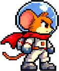
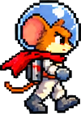
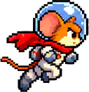
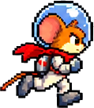
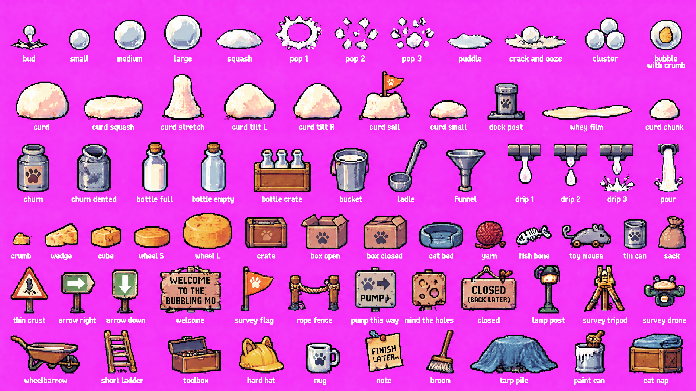
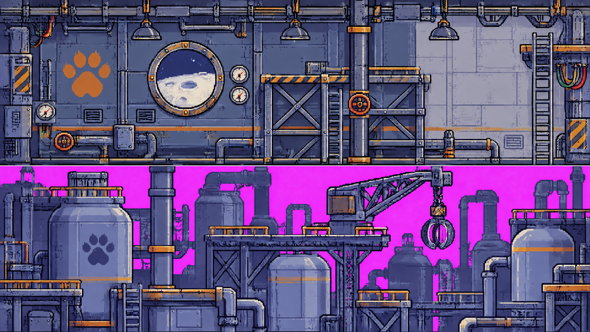

# Space Whiskers: reference art

The owner's sheets, untouched, and every drawing cut from them at its original pixels (`frames/`). Made by `tools/art.py`, which also
writes `ref.json` (the site's ART page reads it). Boxes are x0, y0, x1, y1 on the sheet.

## SNES sprites: the mouse, side view (idle, walking, running, sliding, crouching, jumping, wall sliding)

`pip.png`, 1088 x 608, from the owner (an image model). Its pixel grid sets the scale of the whole game: one art pixel of this sheet is one game pixel (about 2.86 picture pixels; Pip stands about 49 game pixels tall).

| drawing | name | box | used for |
|---|---|---|---|
|  | pip idle | 25, 184, 142, 325 | Pip idle: snapped to the game grid in art/ (the animations) |
|  | pip walk1 | 181, 186, 285, 327 | Pip walking, frame 1 of 4: snapped to the game grid in art/ (the animations) |
|  | pip walk2 | 285, 186, 385, 326 | Pip walking, frame 2 of 4: snapped to the game grid in art/ (the animations) |
|  | pip walk3 | 389, 185, 493, 326 | Pip walking, frame 3 of 4: snapped to the game grid in art/ (the animations) |
|  | pip walk4 | 493, 184, 597, 325 | Pip walking, frame 4 of 4: snapped to the game grid in art/ (the animations) |
|  | pip run1 | 620, 190, 747, 322 | Pip running, frame 1 of 4: snapped to the game grid in art/ (the animations) |
|  | pip run2 | 733, 189, 852, 325 | Pip running, frame 2 of 4: snapped to the game grid in art/ (the animations) |
|  | pip run3 | 846, 190, 957, 323 | Pip running, frame 3 of 4: snapped to the game grid in art/ (the animations) |
|  | pip run4 | 943, 190, 1064, 325 | Pip running, frame 4 of 4: snapped to the game grid in art/ (the animations) |
|  | pip slide | 110, 460, 272, 553 | Pip sliding: snapped to the game grid in art/ (the animations) |
|  | pip slide dust | 38, 505, 107, 553 | Pip sliding: the dust behind him: snapped to the game grid in art/ (the animations) |
|  | pip crouch | 345, 448, 476, 554 | Pip crouching: snapped to the game grid in art/ (the animations) |
|  | pip jump | 571, 397, 699, 542 | Pip jumping: snapped to the game grid in art/ (the animations) |
|  | pip wall slide | 930, 392, 1031, 551 | Pip wall sliding (the wall left out): snapped to the game grid in art/ (the animations) |

## Level inspiration: the Whiskerworks shipyard with the SS Mewoh-1

`levelinspiration.png`, 1088 x 608, from the owner (an image model) Used for: the look of a level: platforms, scaffolding, signs, sleeping cats, cheese (not cut yet).

## Level props: platforms, girders, pipes, machines, crates, signs, cats and ship parts

`levelinspirationprops.png`, 3840 x 2160, from the owner (an image model) Used for: props for the levels, on a green ground (not cut yet).

## Cover: Pip, the cat, the Holy Cow and MEGA-MJAU's fortress (title art still reads "Star Whiskers")

`StarWhiskers-theholycow_cover.png`, 1088 x 608, from the owner (an image model) Used for: the cover and title screen; the look of the cast.

## Bubbling Moon props 1: ground and platforms (glossy, thin and matte crust, floating chunks, Swiss ledges), craters and holes, rocks, plants, decals

`bubblingmoon_terrain.png`, 3840 x 2160, from Claude, through the image API (gpt-image-2.6-flare, high; tools/sheets.mjs). 7 rows. Missing: "crater cap L" (row 3 has 6 of 7). Two labels are garbled ("hole oval", "wall cap"). The paw prints came out pink-purple: they would be eaten by the magenta key. (A first take, made at medium quality with a looser style block, was softer and noisier and is not kept.) Used for: the level's ground, platforms, pits and holes (not cut yet).

## Bubbling Moon props 2: milk bubbles (every state of the pop), the curd boat, milk things, pickups and movables, signs, the builders' leftovers

`bubblingmoon_milk.png`, 3840 x 2160, from Claude, through the image API (gpt-image-2.6-flare, high; tools/sheets.mjs). 6 rows, every item there. The curds have a rosy tint in their shading (check against the magenta key). One label reads "nug" for "mug". Used for: the bubble platforms, the curd, cheese pickups, the pushable wheels, the box and the cat bed, signs (not cut yet).

## Bubbling Moon props 3: the pumping station: pipes, the main pipeline, valves and controls, pumps and tanks, doors, the inside, lights, tools

`bubblingmoon_station.png`, 3840 x 2160, from Claude, through the image API (gpt-image-2.6-flare, high; tools/sheets.mjs). 8 rows. Missing: "map piece 2" (three of the four pieces are there). The piston caps and the tanks' sight glass are tinted pink. Used for: the pumping station and its puzzles: valve wheels, levers, plates, gauges, pumps and tanks, the pump housing, the pipe map and its torn pieces, the plaque and the old photo (not cut yet).

## Bubbling Moon backgrounds, outdoors 1: the sky with the broken Milky Way (top panel) and the far cheese mountains (bottom panel)

`bubblingmoon_bg_outdoor_1.png`, 3840 x 2160, from Claude, through the image API (gpt-image-2.6-flare, high; tools/sheets.mjs). Two panels of 3840 x 1080 picture pixels (960 x 270 game pixels). The seams (left edge into right edge) are not checked yet. Used for: the slowest background layers outdoors: each panel is two screens wide (3840 x 1080), the sky is opaque, the mountains stand on magenta (not cut yet).

## Bubbling Moon backgrounds, outdoors 2: the middle plain with the far pumping station (top panel) and the near cliffs and pipes (bottom panel)

`bubblingmoon_bg_outdoor_2.png`, 3840 x 2160, from Claude, through the image API (gpt-image-2.6-flare, high; tools/sheets.mjs). Two panels of 3840 x 1080 picture pixels. The seams are not checked yet; the middle panel's ground and the near panel's top edge meet at the middle of the sheet. Used for: the middle and near layers outdoors, on magenta (not cut yet).

## Bubbling Moon backgrounds, inside the pumping station: the half-painted back wall (top panel) and the deep machine hall (bottom panel)

`bubblingmoon_bg_station.png`, 3840 x 2160, from Claude, through the image API (gpt-image-2.6-flare, high; tools/sheets.mjs). Two panels of 3840 x 1080 picture pixels. The seams are not checked yet. Used for: the interior layers of the pumping station: the wall is opaque, the deep hall stands on magenta (not cut yet).

## Bubbling Moon foregrounds, outdoors: hanging stalactites, corner rocks, pillars, big low shapes, mist

`bubblingmoon_fg_outdoor.png`, 3840 x 2160, from Claude, through the image API (gpt-image-2.6-flare, high; tools/sheets.mjs). 5 rows, all 31 pieces. The mist banks are pale lavender-pink and would be eaten by the magenta key: they need a cleaner cut (or a redraw). Used for: the front pass outdoors: pieces drawn in front of Pip, which fade where he walks behind them (not cut yet).

## Bubbling Moon foregrounds, inside the pumping station: hanging pipes and cables, machine edges, beams, railings, steam

`bubblingmoon_fg_station.png`, 3840 x 2160, from Claude, through the image API (gpt-image-2.6-flare, high; tools/sheets.mjs). 5 rows, all 31 pieces. The steam, the dust beam and the milk haze are pink-tinted (they would be eaten by the magenta key): they need a cleaner cut or a redraw. Used for: the front pass inside the pumping station: close pipes, cables, machine edges, beams, railings, steam (not cut yet).

