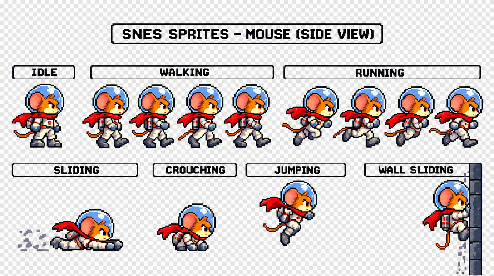
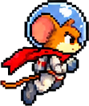
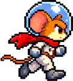
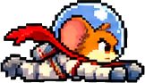
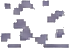
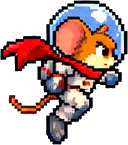
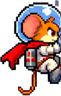
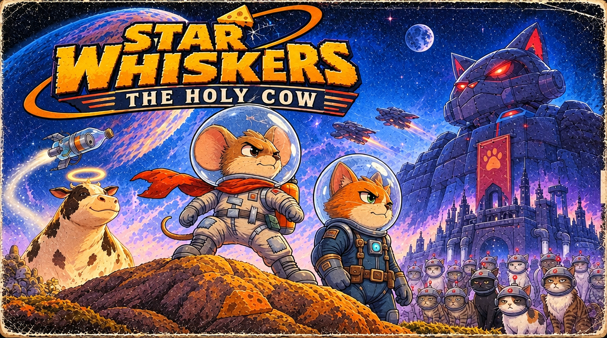

# Space Whiskers: reference art

The owner's sheets, untouched, and every drawing cut from them at its original pixels (`frames/`). Made by `tools/art.py`, which also
writes `ref.json` (the site's ART page reads it). Boxes are x0, y0, x1, y1 on the sheet.

## SNES sprites: the mouse, side view (idle, walking, running, sliding, crouching, jumping, wall sliding)

`pip.png`, 1088 x 608, from the owner (an image model). Its pixel grid sets the scale of the whole game: one art pixel of this sheet is one game pixel (about 2.86 picture pixels; Pip stands about 49 game pixels tall).

| drawing | name | box | used for |
|---|---|---|---|
|  | pip idle | 25, 184, 142, 325 | Pip idle: snapped to the game grid in art/ (the animations) |
|  | pip walk1 | 181, 186, 285, 327 | Pip walking, frame 1 of 4: snapped to the game grid in art/ (the animations) |
|  | pip walk2 | 285, 186, 385, 326 | Pip walking, frame 2 of 4: snapped to the game grid in art/ (the animations) |
|  | pip walk3 | 389, 185, 493, 326 | Pip walking, frame 3 of 4: snapped to the game grid in art/ (the animations) |
|  | pip walk4 | 493, 184, 597, 325 | Pip walking, frame 4 of 4: snapped to the game grid in art/ (the animations) |
|  | pip run1 | 620, 190, 747, 322 | Pip running, frame 1 of 4: snapped to the game grid in art/ (the animations) |
|  | pip run2 | 733, 189, 852, 325 | Pip running, frame 2 of 4: snapped to the game grid in art/ (the animations) |
|  | pip run3 | 846, 190, 957, 323 | Pip running, frame 3 of 4: snapped to the game grid in art/ (the animations) |
|  | pip run4 | 943, 190, 1064, 325 | Pip running, frame 4 of 4: snapped to the game grid in art/ (the animations) |
|  | pip slide | 110, 460, 272, 553 | Pip sliding: snapped to the game grid in art/ (the animations) |
|  | pip slide dust | 38, 505, 107, 553 | Pip sliding: the dust behind him: snapped to the game grid in art/ (the animations) |
|  | pip crouch | 345, 448, 476, 554 | Pip crouching: snapped to the game grid in art/ (the animations) |
|  | pip jump | 571, 397, 699, 542 | Pip jumping: snapped to the game grid in art/ (the animations) |
|  | pip wall slide | 930, 392, 1031, 551 | Pip wall sliding (the wall left out): snapped to the game grid in art/ (the animations) |

## Level inspiration: the Whiskerworks shipyard with the SS Mewoh-1

`levelinspiration.png`, 1088 x 608, from the owner (an image model) Used for: the look of a level: platforms, scaffolding, signs, sleeping cats, cheese (not cut yet).

## Level props: platforms, girders, pipes, machines, crates, signs, cats and ship parts

`levelinspirationprops.png`, 3840 x 2160, from the owner (an image model) Used for: props for the levels, on a green ground (not cut yet).

## Cover: Pip, the cat, the Holy Cow and MEGA-MJAU's fortress (title art still reads "Star Whiskers")

`StarWhiskers-theholycow_cover.png`, 1088 x 608, from the owner (an image model) Used for: the cover and title screen; the look of the cast.

