# Space Whiskers: reference art

The owner's sheets, untouched, and every drawing cut from them at its original pixels (`frames/`). Made by `tools/art.py`, which also
writes `ref.json` (the site's ART page reads it). Boxes are x0, y0, x1, y1 on the sheet.

## SNES sprites: the mouse, side view (idle, walking, running, sliding, crouching, jumping, wall sliding)

`pip.png`, 1088 x 608, from the owner (an image model). Its pixel grid sets the scale of the whole game: one art pixel of this sheet is one game pixel (about 2.86 picture pixels; Pip stands about 49 game pixels tall).

| drawing | name | box | used for |
|---|---|---|---|
|  | pip idle | 25, 184, 142, 325 | Pip idle: snapped to the game grid in art/ (the animations) |
|  | pip walk1 | 181, 186, 285, 327 | Pip walking, frame 1 of 4: snapped to the game grid in art/ (the animations) |
|  | pip walk2 | 285, 186, 385, 326 | Pip walking, frame 2 of 4: snapped to the game grid in art/ (the animations) |
|  | pip walk3 | 389, 185, 493, 326 | Pip walking, frame 3 of 4: snapped to the game grid in art/ (the animations) |
|  | pip walk4 | 493, 184, 597, 325 | Pip walking, frame 4 of 4: snapped to the game grid in art/ (the animations) |
|  | pip run1 | 620, 190, 747, 322 | Pip running, frame 1 of 4: snapped to the game grid in art/ (the animations) |
|  | pip run2 | 733, 189, 852, 325 | Pip running, frame 2 of 4: snapped to the game grid in art/ (the animations) |
|  | pip run3 | 846, 190, 957, 323 | Pip running, frame 3 of 4: snapped to the game grid in art/ (the animations) |
|  | pip run4 | 943, 190, 1064, 325 | Pip running, frame 4 of 4: snapped to the game grid in art/ (the animations) |
|  | pip slide | 110, 460, 272, 553 | Pip sliding: snapped to the game grid in art/ (the animations) |
|  | pip slide dust | 38, 505, 107, 553 | Pip sliding: the dust behind him: snapped to the game grid in art/ (the animations) |
|  | pip crouch | 345, 448, 476, 554 | Pip crouching: snapped to the game grid in art/ (the animations) |
|  | pip jump | 571, 397, 699, 542 | Pip jumping: snapped to the game grid in art/ (the animations) |
|  | pip wall slide | 930, 392, 1031, 551 | Pip wall sliding (the wall left out): snapped to the game grid in art/ (the animations) |

## Level inspiration: the Whiskerworks shipyard with the SS Mewoh-1

`levelinspiration.png`, 1088 x 608, from the owner (an image model) Used for: the look of a level: platforms, scaffolding, signs, sleeping cats, cheese (not cut yet).

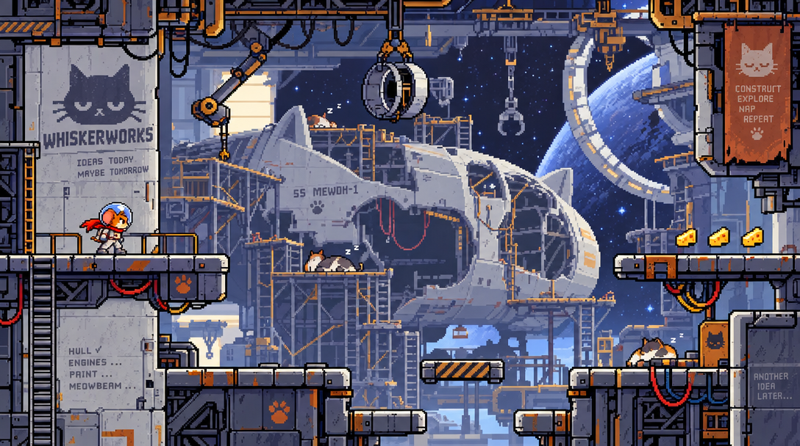

## Level props: platforms, girders, pipes, machines, crates, signs, cats and ship parts

`levelinspirationprops.png`, 3840 x 2160, from the owner (an image model) Used for: props for the levels, on a green ground (not cut yet).

## Cover: Pip, the cat, the Holy Cow and MEGA-MJAU's fortress (title art still reads "Star Whiskers")

`StarWhiskers-theholycow_cover.png`, 1088 x 608, from the owner (an image model) Used for: the cover and title screen; the look of the cast.

## Bubbling Moon props 1: ground and platforms (glossy, thin and matte crust, floating chunks, Swiss ledges), craters and holes, rocks, plants, decals

`bubblingmoon_terrain.png`, 3840 x 2160, from Claude, through the image API (gpt-image-2.6-flare, high; tools/sheets.mjs). 7 rows, cut into 69 sprites (tools/cut_sheets.py). Missing: "crater cap L" (row 3 has 6 of 7); "swiss edge R" was drawn twice (the second is "swiss edge R 2"); two labels are garbled ("hole oval", "wall cap"). The paw prints came out pink-purple, so the key left only fragments of them. (A first take, made at medium quality with a looser style block, was softer and noisier and is not kept.) Used for: the level's ground, platforms, pits and holes (not cut yet).

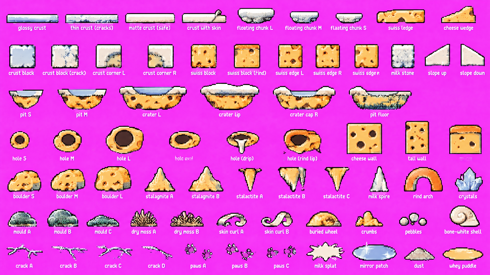

| drawing | name | box | used for |
|---|---|---|---|
|  | terrain glossy crust | 50, 111, 458, 182 | Bubbling Moon terrain (ground, platforms, craters, holes, rocks, decals), row 1: not in a game yet |
|  | terrain thin crust (cracks) | 511, 111, 928, 186 | Bubbling Moon terrain (ground, platforms, craters, holes, rocks, decals), row 1: not in a game yet |
|  | terrain matte crust (safe) | 981, 103, 1371, 183 | Bubbling Moon terrain (ground, platforms, craters, holes, rocks, decals), row 1: not in a game yet |
|  | terrain crust with skin | 1426, 74, 1774, 184 | Bubbling Moon terrain (ground, platforms, craters, holes, rocks, decals), row 1: not in a game yet |
|  | terrain floating chunk L | 1862, 63, 2152, 184 | Bubbling Moon terrain (ground, platforms, craters, holes, rocks, decals), row 1: not in a game yet |
|  | terrain floating chunk M | 2272, 89, 2498, 184 | Bubbling Moon terrain (ground, platforms, craters, holes, rocks, decals), row 1: not in a game yet |
|  | terrain floating chunk S | 2630, 103, 2843, 184 | Bubbling Moon terrain (ground, platforms, craters, holes, rocks, decals), row 1: not in a game yet |
|  | terrain swiss ledge | 2952, 74, 3330, 184 | Bubbling Moon terrain (ground, platforms, craters, holes, rocks, decals), row 1: not in a game yet |
|  | terrain cheese wedge | 3457, 47, 3729, 182 | Bubbling Moon terrain (ground, platforms, craters, holes, rocks, decals), row 1: not in a game yet |
| 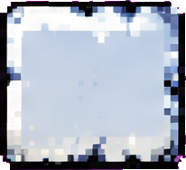 | terrain crust block | 73, 349, 279, 537 | Bubbling Moon terrain (ground, platforms, craters, holes, rocks, decals), row 2: not in a game yet |
|  | terrain crust block (crack) | 401, 351, 616, 538 | Bubbling Moon terrain (ground, platforms, craters, holes, rocks, decals), row 2: not in a game yet |
|  | terrain crust corner L | 749, 347, 954, 537 | Bubbling Moon terrain (ground, platforms, craters, holes, rocks, decals), row 2: not in a game yet |
| 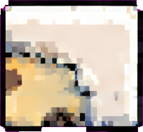 | terrain crust corner R | 1157, 347, 1361, 536 | Bubbling Moon terrain (ground, platforms, craters, holes, rocks, decals), row 2: not in a game yet |
|  | terrain swiss block | 1495, 347, 1698, 536 | Bubbling Moon terrain (ground, platforms, craters, holes, rocks, decals), row 2: not in a game yet |
| 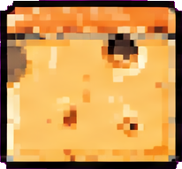 | terrain swiss block (rind) | 1833, 345, 2039, 536 | Bubbling Moon terrain (ground, platforms, craters, holes, rocks, decals), row 2: not in a game yet |
| 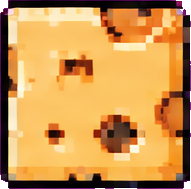 | terrain swiss edge L | 2180, 347, 2371, 536 | Bubbling Moon terrain (ground, platforms, craters, holes, rocks, decals), row 2: not in a game yet |
| 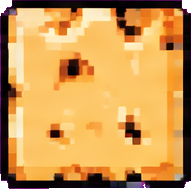 | terrain swiss edge R | 2473, 347, 2664, 536 | Bubbling Moon terrain (ground, platforms, craters, holes, rocks, decals), row 2: not in a game yet |
|  | terrain swiss edge R 2 | 2778, 347, 2967, 536 | Bubbling Moon terrain (ground, platforms, craters, holes, rocks, decals), row 2: not in a game yet |
|  | terrain milk stone | 3066, 346, 3248, 537 | Bubbling Moon terrain (ground, platforms, craters, holes, rocks, decals), row 2: not in a game yet |
|  | terrain slope up | 3329, 345, 3527, 519 | Bubbling Moon terrain (ground, platforms, craters, holes, rocks, decals), row 2: not in a game yet |
| 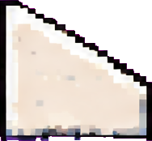 | terrain slope down | 3610, 345, 3798, 519 | Bubbling Moon terrain (ground, platforms, craters, holes, rocks, decals), row 2: not in a game yet |
|  | terrain pit S | 69, 704, 341, 854 | Bubbling Moon terrain (ground, platforms, craters, holes, rocks, decals), row 3: not in a game yet |
|  | terrain pit M | 450, 698, 836, 861 | Bubbling Moon terrain (ground, platforms, craters, holes, rocks, decals), row 3: not in a game yet |
|  | terrain crater L | 934, 675, 1464, 865 | Bubbling Moon terrain (ground, platforms, craters, holes, rocks, decals), row 3: not in a game yet |
| 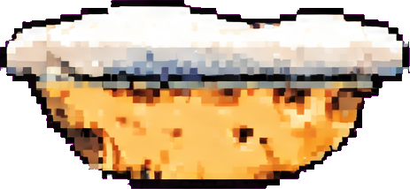 | terrain crater lip | 1569, 651, 2032, 865 | Bubbling Moon terrain (ground, platforms, craters, holes, rocks, decals), row 3: not in a game yet |
|  | terrain crater cap R | 2139, 675, 2629, 861 | Bubbling Moon terrain (ground, platforms, craters, holes, rocks, decals), row 3: not in a game yet |
|  | terrain pit floor | 2734, 676, 3226, 861 | Bubbling Moon terrain (ground, platforms, craters, holes, rocks, decals), row 3: not in a game yet |
| 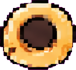 | terrain hole S | 79, 1031, 231, 1172 | Bubbling Moon terrain (ground, platforms, craters, holes, rocks, decals), row 4: not in a game yet |
|  | terrain hole M | 417, 1017, 640, 1196 | Bubbling Moon terrain (ground, platforms, craters, holes, rocks, decals), row 4: not in a game yet |
| 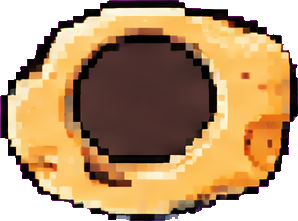 | terrain hole L | 828, 988, 1126, 1209 | Bubbling Moon terrain (ground, platforms, craters, holes, rocks, decals), row 4: not in a game yet |
|  | terrain hole oval | 1325, 1029, 1572, 1172 | Bubbling Moon terrain (ground, platforms, craters, holes, rocks, decals), row 4: not in a game yet |
| 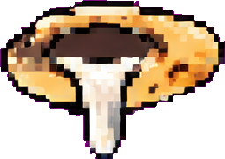 | terrain hole (drip) | 1776, 1029, 2031, 1209 | Bubbling Moon terrain (ground, platforms, craters, holes, rocks, decals), row 4: not in a game yet |
| 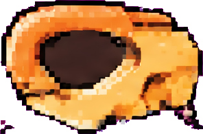 | terrain hole (rind lip) | 2222, 1014, 2518, 1209 | Bubbling Moon terrain (ground, platforms, craters, holes, rocks, decals), row 4: not in a game yet |
| 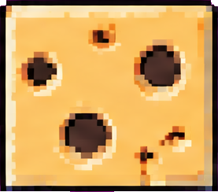 | terrain cheese wall | 2717, 966, 2994, 1210 | Bubbling Moon terrain (ground, platforms, craters, holes, rocks, decals), row 4: not in a game yet |
| 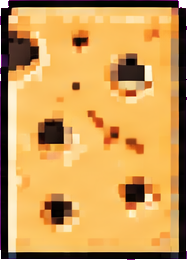 | terrain tall wall | 3176, 950, 3363, 1210 | Bubbling Moon terrain (ground, platforms, craters, holes, rocks, decals), row 4: not in a game yet |
| 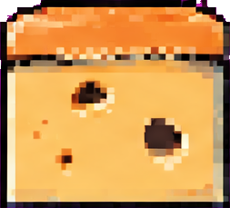 | terrain wall cap | 3521, 980, 3774, 1209 | Bubbling Moon terrain (ground, platforms, craters, holes, rocks, decals), row 4: not in a game yet |
| 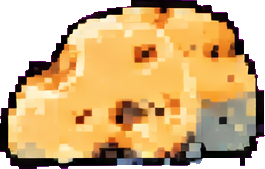 | terrain boulder S | 59, 1338, 324, 1507 | Bubbling Moon terrain (ground, platforms, craters, holes, rocks, decals), row 5: not in a game yet |
|  | terrain boulder M | 397, 1327, 668, 1505 | Bubbling Moon terrain (ground, platforms, craters, holes, rocks, decals), row 5: not in a game yet |
| 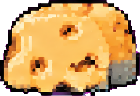 | terrain boulder L | 741, 1306, 1030, 1504 | Bubbling Moon terrain (ground, platforms, craters, holes, rocks, decals), row 5: not in a game yet |
| 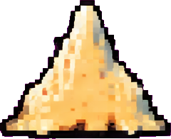 | terrain stalagmite A | 1133, 1312, 1373, 1508 | Bubbling Moon terrain (ground, platforms, craters, holes, rocks, decals), row 5: not in a game yet |
| 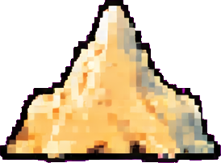 | terrain stalagmite B | 1477, 1306, 1751, 1508 | Bubbling Moon terrain (ground, platforms, craters, holes, rocks, decals), row 5: not in a game yet |
| 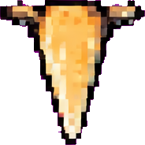 | terrain stalactite A | 1869, 1320, 2053, 1504 | Bubbling Moon terrain (ground, platforms, craters, holes, rocks, decals), row 5: not in a game yet |
| 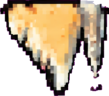 | terrain stalactite B | 2178, 1312, 2400, 1508 | Bubbling Moon terrain (ground, platforms, craters, holes, rocks, decals), row 5: not in a game yet |
|  | terrain stalactite C | 2543, 1312, 2737, 1504 | Bubbling Moon terrain (ground, platforms, craters, holes, rocks, decals), row 5: not in a game yet |
|  | terrain milk spire | 2896, 1306, 3048, 1508 | Bubbling Moon terrain (ground, platforms, craters, holes, rocks, decals), row 5: not in a game yet |
|  | terrain rind arch | 3165, 1312, 3470, 1504 | Bubbling Moon terrain (ground, platforms, craters, holes, rocks, decals), row 5: not in a game yet |
|  | terrain crystals | 3565, 1312, 3784, 1504 | Bubbling Moon terrain (ground, platforms, craters, holes, rocks, decals), row 5: not in a game yet |
| 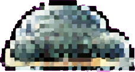 | terrain mould A | 60, 1660, 288, 1782 | Bubbling Moon terrain (ground, platforms, craters, holes, rocks, decals), row 6: not in a game yet |
| 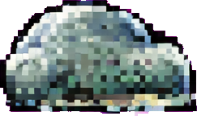 | terrain mould B | 371, 1641, 614, 1785 | Bubbling Moon terrain (ground, platforms, craters, holes, rocks, decals), row 6: not in a game yet |
|  | terrain mould C | 679, 1687, 934, 1780 | Bubbling Moon terrain (ground, platforms, craters, holes, rocks, decals), row 6: not in a game yet |
| 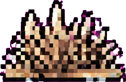 | terrain dry moss A | 1021, 1641, 1233, 1780 | Bubbling Moon terrain (ground, platforms, craters, holes, rocks, decals), row 6: not in a game yet |
| 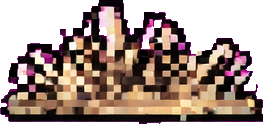 | terrain dry moss B | 1333, 1658, 1596, 1782 | Bubbling Moon terrain (ground, platforms, craters, holes, rocks, decals), row 6: not in a game yet |
|  | terrain skin curl A | 1696, 1671, 1934, 1780 | Bubbling Moon terrain (ground, platforms, craters, holes, rocks, decals), row 6: not in a game yet |
|  | terrain skin curl B | 2046, 1660, 2294, 1783 | Bubbling Moon terrain (ground, platforms, craters, holes, rocks, decals), row 6: not in a game yet |
| 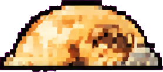 | terrain buried wheel | 2399, 1660, 2677, 1783 | Bubbling Moon terrain (ground, platforms, craters, holes, rocks, decals), row 6: not in a game yet |
| 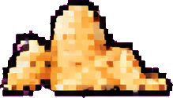 | terrain crumbs | 2784, 1657, 3003, 1782 | Bubbling Moon terrain (ground, platforms, craters, holes, rocks, decals), row 6: not in a game yet |
| 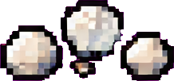 | terrain pebbles | 3128, 1671, 3346, 1773 | Bubbling Moon terrain (ground, platforms, craters, holes, rocks, decals), row 6: not in a game yet |
|  | terrain bone-white shell | 3524, 1614, 3759, 1783 | Bubbling Moon terrain (ground, platforms, craters, holes, rocks, decals), row 6: not in a game yet |
|  | terrain crack A | 51, 1919, 335, 2034 | Bubbling Moon terrain (ground, platforms, craters, holes, rocks, decals), row 7: not in a game yet |
|  | terrain crack B | 404, 1929, 684, 2039 | Bubbling Moon terrain (ground, platforms, craters, holes, rocks, decals), row 7: not in a game yet |
|  | terrain crack C | 758, 1921, 1037, 2025 | Bubbling Moon terrain (ground, platforms, craters, holes, rocks, decals), row 7: not in a game yet |
|  | terrain crack D | 1110, 1929, 1350, 2034 | Bubbling Moon terrain (ground, platforms, craters, holes, rocks, decals), row 7: not in a game yet |
|  | terrain paws A | 1448, 1913, 1665, 2040 | Bubbling Moon terrain (ground, platforms, craters, holes, rocks, decals), row 7: not in a game yet |
| 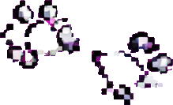 | terrain paws B | 1769, 1913, 1988, 2046 | Bubbling Moon terrain (ground, platforms, craters, holes, rocks, decals), row 7: not in a game yet |
| 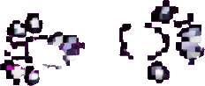 | terrain paws C | 2089, 1928, 2321, 2026 | Bubbling Moon terrain (ground, platforms, craters, holes, rocks, decals), row 7: not in a game yet |
|  | terrain milk splat | 2399, 1898, 2699, 2054 | Bubbling Moon terrain (ground, platforms, craters, holes, rocks, decals), row 7: not in a game yet |
|  | terrain mirror patch | 2761, 1899, 3108, 2047 | Bubbling Moon terrain (ground, platforms, craters, holes, rocks, decals), row 7: not in a game yet |
|  | terrain dust | 3168, 1943, 3407, 2047 | Bubbling Moon terrain (ground, platforms, craters, holes, rocks, decals), row 7: not in a game yet |
|  | terrain whey puddle | 3469, 1943, 3787, 2047 | Bubbling Moon terrain (ground, platforms, craters, holes, rocks, decals), row 7: not in a game yet |

## Bubbling Moon props 2: milk bubbles (every state of the pop), the curd boat, milk things, pickups and movables, signs, the builders' leftovers

`bubblingmoon_milk.png`, 3840 x 2160, from Claude, through the image API (gpt-image-2.6-flare, high; tools/sheets.mjs). 6 rows, every item there, cut into 70 sprites (tools/cut_sheets.py). The curds have a rosy tint in their shading; a few tiny gaps (rope fence, ladder) still keep pink specks. One label reads "nug" for "mug". Used for: the bubble platforms, the curd, cheese pickups, the pushable wheels, the box and the cat bed, signs (not cut yet).

| drawing | name | box | used for |
|---|---|---|---|
|  | milk bud | 58, 137, 264, 276 | Bubbling Moon milk and movable props, row 1: not in a game yet |
|  | milk small | 380, 160, 498, 277 | Bubbling Moon milk and movable props, row 1: not in a game yet |
|  | milk medium | 629, 109, 805, 277 | Bubbling Moon milk and movable props, row 1: not in a game yet |
|  | milk large | 906, 81, 1113, 277 | Bubbling Moon milk and movable props, row 1: not in a game yet |
|  | milk squash | 1191, 160, 1452, 269 | Bubbling Moon milk and movable props, row 1: not in a game yet |
|  | milk pop 1 | 1521, 81, 1776, 277 | Bubbling Moon milk and movable props, row 1: not in a game yet |
| 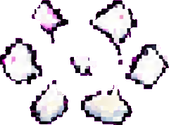 | milk pop 2 | 1846, 96, 2086, 274 | Bubbling Moon milk and movable props, row 1: not in a game yet |
|  | milk pop 3 | 2154, 96, 2397, 269 | Bubbling Moon milk and movable props, row 1: not in a game yet |
|  | milk puddle | 2467, 185, 2717, 269 | Bubbling Moon milk and movable props, row 1: not in a game yet |
|  | milk crack and ooze | 2784, 144, 3123, 273 | Bubbling Moon milk and movable props, row 1: not in a game yet |
|  | milk cluster | 3228, 96, 3450, 277 | Bubbling Moon milk and movable props, row 1: not in a game yet |
| 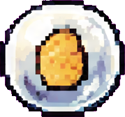 | milk bubble with crumb | 3586, 109, 3765, 277 | Bubbling Moon milk and movable props, row 1: not in a game yet |
|  | milk curd | 86, 451, 380, 662 | Bubbling Moon milk and movable props, row 2: not in a game yet |
|  | milk curd squash | 462, 527, 790, 661 | Bubbling Moon milk and movable props, row 2: not in a game yet |
|  | milk curd stretch | 895, 408, 1125, 662 | Bubbling Moon milk and movable props, row 2: not in a game yet |
|  | milk curd tilt L | 1237, 458, 1521, 661 | Bubbling Moon milk and movable props, row 2: not in a game yet |
| 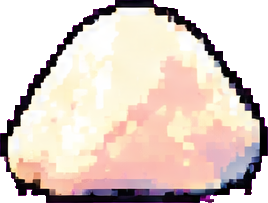 | milk curd tilt R | 1617, 458, 1885, 661 | Bubbling Moon milk and movable props, row 2: not in a game yet |
|  | milk curd sail | 1981, 392, 2263, 662 | Bubbling Moon milk and movable props, row 2: not in a game yet |
|  | milk curd small | 2365, 554, 2583, 661 | Bubbling Moon milk and movable props, row 2: not in a game yet |
|  | milk dock post | 2689, 458, 2896, 662 | Bubbling Moon milk and movable props, row 2: not in a game yet |
|  | milk whey film | 2992, 580, 3487, 661 | Bubbling Moon milk and movable props, row 2: not in a game yet |
|  | milk curd chunk | 3583, 547, 3749, 662 | Bubbling Moon milk and movable props, row 2: not in a game yet |
|  | milk churn | 95, 794, 272, 1063 | Bubbling Moon milk and movable props, row 3: not in a game yet |
|  | milk churn dented | 426, 794, 610, 1063 | Bubbling Moon milk and movable props, row 3: not in a game yet |
| 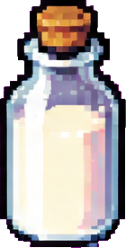 | milk bottle full | 786, 787, 926, 1063 | Bubbling Moon milk and movable props, row 3: not in a game yet |
| 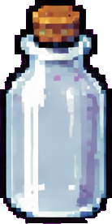 | milk bottle empty | 1109, 787, 1247, 1063 | Bubbling Moon milk and movable props, row 3: not in a game yet |
| 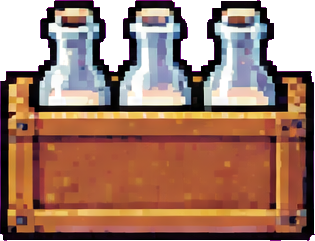 | milk bottle crate | 1400, 822, 1715, 1063 | Bubbling Moon milk and movable props, row 3: not in a game yet |
|  | milk bucket | 1823, 818, 2035, 1063 | Bubbling Moon milk and movable props, row 3: not in a game yet |
|  | milk ladle | 2142, 770, 2355, 1063 | Bubbling Moon milk and movable props, row 3: not in a game yet |
|  | milk funnel | 2460, 823, 2679, 1062 | Bubbling Moon milk and movable props, row 3: not in a game yet |
| 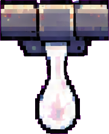 | milk drip 1 | 2803, 794, 2983, 1015 | Bubbling Moon milk and movable props, row 3: not in a game yet |
| 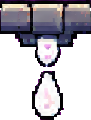 | milk drip 2 | 3056, 794, 3236, 1030 | Bubbling Moon milk and movable props, row 3: not in a game yet |
|  | milk drip 3 | 3310, 794, 3502, 1062 | Bubbling Moon milk and movable props, row 3: not in a game yet |
|  | milk pour | 3610, 794, 3767, 1062 | Bubbling Moon milk and movable props, row 3: not in a game yet |
|  | milk crumb | 69, 1284, 177, 1356 | Bubbling Moon milk and movable props, row 4: not in a game yet |
| 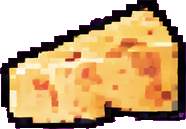 | milk wedge | 246, 1234, 432, 1363 | Bubbling Moon milk and movable props, row 4: not in a game yet |
| 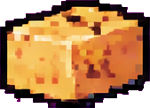 | milk cube | 501, 1246, 670, 1368 | Bubbling Moon milk and movable props, row 4: not in a game yet |
| 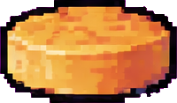 | milk wheel S | 739, 1251, 939, 1368 | Bubbling Moon milk and movable props, row 4: not in a game yet |
|  | milk wheel L | 1008, 1175, 1281, 1375 | Bubbling Moon milk and movable props, row 4: not in a game yet |
| 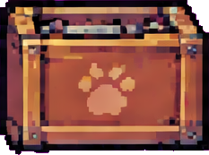 | milk crate | 1353, 1200, 1586, 1373 | Bubbling Moon milk and movable props, row 4: not in a game yet |
|  | milk box open | 1658, 1183, 1927, 1375 | Bubbling Moon milk and movable props, row 4: not in a game yet |
|  | milk box closed | 2008, 1186, 2246, 1376 | Bubbling Moon milk and movable props, row 4: not in a game yet |
|  | milk cat bed | 2312, 1227, 2557, 1375 | Bubbling Moon milk and movable props, row 4: not in a game yet |
| 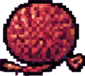 | milk yarn | 2618, 1222, 2789, 1376 | Bubbling Moon milk and movable props, row 4: not in a game yet |
|  | milk fish bone | 2845, 1244, 3043, 1368 | Bubbling Moon milk and movable props, row 4: not in a game yet |
|  | milk toy mouse | 3098, 1235, 3373, 1368 | Bubbling Moon milk and movable props, row 4: not in a game yet |
| 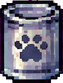 | milk tin can | 3441, 1211, 3567, 1375 | Bubbling Moon milk and movable props, row 4: not in a game yet |
|  | milk sack | 3630, 1192, 3784, 1375 | Bubbling Moon milk and movable props, row 4: not in a game yet |
| 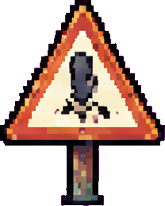 | milk thin crust | 58, 1473, 266, 1732 | Bubbling Moon milk and movable props, row 5: not in a game yet |
|  | milk arrow right | 339, 1503, 524, 1732 | Bubbling Moon milk and movable props, row 5: not in a game yet |
|  | milk arrow down | 617, 1488, 764, 1732 | Bubbling Moon milk and movable props, row 5: not in a game yet |
| 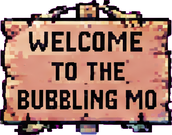 | milk welcome | 883, 1466, 1219, 1731 | Bubbling Moon milk and movable props, row 5: not in a game yet |
|  | milk survey flag | 1327, 1472, 1513, 1719 | Bubbling Moon milk and movable props, row 5: not in a game yet |
|  | milk rope fence | 1591, 1518, 1875, 1719 | Bubbling Moon milk and movable props, row 5: not in a game yet |
|  | milk pump this way | 1958, 1476, 2186, 1726 | Bubbling Moon milk and movable props, row 5: not in a game yet |
| 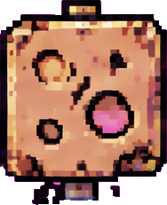 | milk mind the holes | 2273, 1488, 2461, 1719 | Bubbling Moon milk and movable props, row 5: not in a game yet |
|  | milk closed | 2545, 1466, 2850, 1719 | Bubbling Moon milk and movable props, row 5: not in a game yet |
|  | milk lamp post | 2946, 1466, 3089, 1732 | Bubbling Moon milk and movable props, row 5: not in a game yet |
| 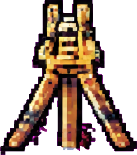 | milk survey tripod | 3222, 1466, 3450, 1725 | Bubbling Moon milk and movable props, row 5: not in a game yet |
|  | milk survey drone | 3553, 1520, 3781, 1698 | Bubbling Moon milk and movable props, row 5: not in a game yet |
| 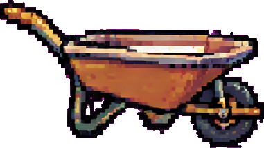 | milk wheelbarrow | 58, 1850, 439, 2064 | Bubbling Moon milk and movable props, row 6: not in a game yet |
|  | milk short ladder | 573, 1823, 756, 2063 | Bubbling Moon milk and movable props, row 6: not in a game yet |
|  | milk toolbox | 927, 1854, 1218, 2064 | Bubbling Moon milk and movable props, row 6: not in a game yet |
|  | milk hard hat | 1318, 1854, 1569, 2063 | Bubbling Moon milk and movable props, row 6: not in a game yet |
|  | milk mug | 1689, 1893, 1875, 2064 | Bubbling Moon milk and movable props, row 6: not in a game yet |
|  | milk note | 2016, 1822, 2227, 2056 | Bubbling Moon milk and movable props, row 6: not in a game yet |
|  | milk broom | 2353, 1822, 2507, 2064 | Bubbling Moon milk and movable props, row 6: not in a game yet |
|  | milk tarp pile | 2592, 1849, 3077, 2064 | Bubbling Moon milk and movable props, row 6: not in a game yet |
|  | milk paint can | 3170, 1822, 3338, 2064 | Bubbling Moon milk and movable props, row 6: not in a game yet |
|  | milk cat nap | 3471, 1842, 3768, 2064 | Bubbling Moon milk and movable props, row 6: not in a game yet |

## Bubbling Moon props 3: the pumping station: pipes, the main pipeline, valves and controls, pumps and tanks, doors, the inside, lights, tools

`bubblingmoon_station.png`, 3840 x 2160, from Claude, through the image API (gpt-image-2.6-flare, high; tools/sheets.mjs). 8 rows, cut into 90 sprites (tools/cut_sheets.py). Missing: "map piece 2" (three of the four pieces are there) and the separate "pump housing" (the story's fuel tank: the three "tank" canisters are the nearest thing). The model moved "wrench", "big wrench" and "oil can" up to the lights row. The piston caps and the tanks' sight glass are tinted pink; the ladders keep pink specks between the rungs. Used for: the pumping station and its puzzles: valve wheels, levers, plates, gauges, pumps and tanks, the pump housing, the pipe map and its torn pieces, the plaque and the old photo (not cut yet).

| drawing | name | box | used for |
|---|---|---|---|
|  | station pipe S | 61, 71, 244, 158 | Bubbling Moon pumping-station props, row 1: not in a game yet |
|  | station pipe M | 304, 70, 534, 158 | Bubbling Moon pumping-station props, row 1: not in a game yet |
|  | station pipe L | 583, 69, 924, 158 | Bubbling Moon pumping-station props, row 1: not in a game yet |
|  | station pipe up S | 1053, 44, 1143, 198 | Bubbling Moon pumping-station props, row 1: not in a game yet |
|  | station pipe up L | 1281, 44, 1371, 199 | Bubbling Moon pumping-station props, row 1: not in a game yet |
|  | station elbow NE | 1493, 62, 1639, 194 | Bubbling Moon pumping-station props, row 1: not in a game yet |
|  | station elbow NW | 1727, 61, 1878, 193 | Bubbling Moon pumping-station props, row 1: not in a game yet |
|  | station elbow SE | 1960, 61, 2104, 194 | Bubbling Moon pumping-station props, row 1: not in a game yet |
|  | station elbow SW | 2202, 61, 2349, 194 | Bubbling Moon pumping-station props, row 1: not in a game yet |
|  | station tee | 2416, 67, 2614, 194 | Bubbling Moon pumping-station props, row 1: not in a game yet |
|  | station cross | 2697, 44, 2875, 195 | Bubbling Moon pumping-station props, row 1: not in a game yet |
|  | station window pipe | 2974, 64, 3286, 176 | Bubbling Moon pumping-station props, row 1: not in a game yet |
|  | station open end | 3393, 61, 3473, 177 | Bubbling Moon pumping-station props, row 1: not in a game yet |
|  | station unfinished | 3576, 65, 3791, 170 | Bubbling Moon pumping-station props, row 1: not in a game yet |
|  | station main L | 61, 319, 585, 469 | Bubbling Moon pumping-station props, row 2: not in a game yet |
|  | station main M | 704, 319, 1110, 469 | Bubbling Moon pumping-station props, row 2: not in a game yet |
|  | station main up | 1192, 319, 1504, 510 | Bubbling Moon pumping-station props, row 2: not in a game yet |
|  | station main down | 1574, 319, 1846, 509 | Bubbling Moon pumping-station props, row 2: not in a game yet |
|  | station main tee | 1918, 267, 2274, 486 | Bubbling Moon pumping-station props, row 2: not in a game yet |
|  | station main end | 2371, 303, 2767, 517 | Bubbling Moon pumping-station props, row 2: not in a game yet |
|  | station main support | 2889, 268, 3346, 517 | Bubbling Moon pumping-station props, row 2: not in a game yet |
|  | station main ladder | 3566, 267, 3718, 523 | Bubbling Moon pumping-station props, row 2: not in a game yet |
|  | station wheel red | 46, 604, 242, 777 | Bubbling Moon pumping-station props, row 3: not in a game yet |
|  | station wheel blue | 304, 604, 495, 777 | Bubbling Moon pumping-station props, row 3: not in a game yet |
|  | station wheel yellow | 559, 603, 803, 777 | Bubbling Moon pumping-station props, row 3: not in a game yet |
|  | station lever up | 899, 587, 1061, 777 | Bubbling Moon pumping-station props, row 3: not in a game yet |
|  | station lever down | 1142, 649, 1316, 765 | Bubbling Moon pumping-station props, row 3: not in a game yet |
|  | station button off | 1399, 680, 1589, 783 | Bubbling Moon pumping-station props, row 3: not in a game yet |
|  | station button on | 1656, 680, 1845, 783 | Bubbling Moon pumping-station props, row 3: not in a game yet |
|  | station plate up | 1913, 680, 2160, 783 | Bubbling Moon pumping-station props, row 3: not in a game yet |
|  | station plate down | 2208, 680, 2458, 783 | Bubbling Moon pumping-station props, row 3: not in a game yet |
|  | station switchbox | 2552, 635, 2717, 777 | Bubbling Moon pumping-station props, row 3: not in a game yet |
|  | station gauge low | 2799, 620, 2967, 783 | Bubbling Moon pumping-station props, row 3: not in a game yet |
|  | station gauge ok | 3059, 620, 3229, 783 | Bubbling Moon pumping-station props, row 3: not in a game yet |
|  | station gauge broken | 3322, 620, 3494, 783 | Bubbling Moon pumping-station props, row 3: not in a game yet |
|  | station hiccup lamp | 3621, 624, 3790, 784 | Bubbling Moon pumping-station props, row 3: not in a game yet |
|  | station main pump | 46, 860, 741, 1152 | Bubbling Moon pumping-station props, row 4: not in a game yet |
|  | station tank full | 874, 874, 1064, 1141 | Bubbling Moon pumping-station props, row 4: not in a game yet |
|  | station tank half | 1140, 874, 1325, 1140 | Bubbling Moon pumping-station props, row 4: not in a game yet |
|  | station tank empty | 1393, 874, 1573, 1140 | Bubbling Moon pumping-station props, row 4: not in a game yet |
|  | station silo | 1685, 874, 1841, 1140 | Bubbling Moon pumping-station props, row 4: not in a game yet |
|  | station piston 1 | 1966, 883, 2103, 1140 | Bubbling Moon pumping-station props, row 4: not in a game yet |
|  | station piston 2 | 2231, 874, 2362, 1140 | Bubbling Moon pumping-station props, row 4: not in a game yet |
|  | station piston 3 | 2489, 874, 2621, 1140 | Bubbling Moon pumping-station props, row 4: not in a game yet |
|  | station bellows | 2768, 893, 2945, 1138 | Bubbling Moon pumping-station props, row 4: not in a game yet |
|  | station bellows flat | 3023, 946, 3285, 1135 | Bubbling Moon pumping-station props, row 4: not in a game yet |
|  | station half fan | 3489, 874, 3804, 1146 | Bubbling Moon pumping-station props, row 4: not in a game yet |
|  | station door shut | 46, 1249, 275, 1457 | Bubbling Moon pumping-station props, row 5: not in a game yet |
|  | station door open | 361, 1249, 585, 1456 | Bubbling Moon pumping-station props, row 5: not in a game yet |
|  | station shutter shut | 679, 1254, 929, 1457 | Bubbling Moon pumping-station props, row 5: not in a game yet |
|  | station shutter open | 1037, 1254, 1281, 1456 | Bubbling Moon pumping-station props, row 5: not in a game yet |
|  | station hatch | 1377, 1262, 1589, 1452 | Bubbling Moon pumping-station props, row 5: not in a game yet |
|  | station vent | 1678, 1271, 1876, 1444 | Bubbling Moon pumping-station props, row 5: not in a game yet |
|  | station ladder | 1997, 1231, 2081, 1459 | Bubbling Moon pumping-station props, row 5: not in a game yet |
|  | station catwalk | 2183, 1279, 2578, 1452 | Bubbling Moon pumping-station props, row 5: not in a game yet |
|  | station stairs | 2654, 1246, 2914, 1460 | Bubbling Moon pumping-station props, row 5: not in a game yet |
|  | station porthole | 2971, 1248, 3171, 1452 | Bubbling Moon pumping-station props, row 5: not in a game yet |
|  | station entrance | 3250, 1230, 3487, 1468 | Bubbling Moon pumping-station props, row 5: not in a game yet |
|  | station scaffold | 3575, 1230, 3804, 1468 | Bubbling Moon pumping-station props, row 5: not in a game yet |
|  | station control desk | 46, 1535, 364, 1709 | Bubbling Moon pumping-station props, row 6: not in a game yet |
|  | station drafting table | 422, 1545, 713, 1706 | Bubbling Moon pumping-station props, row 6: not in a game yet |
|  | station notice board | 802, 1534, 1064, 1705 | Bubbling Moon pumping-station props, row 6: not in a game yet |
|  | station pipe map | 1160, 1534, 1574, 1699 | Bubbling Moon pumping-station props, row 6: not in a game yet |
|  | station map piece 1 | 1688, 1529, 1859, 1703 | Bubbling Moon pumping-station props, row 6: not in a game yet |
|  | station map piece 3 | 1904, 1529, 2075, 1704 | Bubbling Moon pumping-station props, row 6: not in a game yet |
|  | station map piece 4 | 2120, 1529, 2298, 1702 | Bubbling Moon pumping-station props, row 6: not in a game yet |
|  | station plaque | 2495, 1529, 2742, 1705 | Bubbling Moon pumping-station props, row 6: not in a game yet |
|  | station photo | 2879, 1534, 3139, 1703 | Bubbling Moon pumping-station props, row 6: not in a game yet |
|  | station filing cabinet | 3282, 1529, 3418, 1704 | Bubbling Moon pumping-station props, row 6: not in a game yet |
|  | station stopped clock | 3591, 1529, 3777, 1703 | Bubbling Moon pumping-station props, row 6: not in a game yet |
|  | station ceiling lamp | 61, 1776, 246, 1934 | Bubbling Moon pumping-station props, row 7: not in a game yet |
|  | station work light | 398, 1782, 509, 1938 | Bubbling Moon pumping-station props, row 7: not in a game yet |
|  | station siren | 686, 1792, 819, 1912 | Bubbling Moon pumping-station props, row 7: not in a game yet |
|  | station hazard stripes | 945, 1792, 1172, 1920 | Bubbling Moon pumping-station props, row 7: not in a game yet |
|  | station hazard sign | 1297, 1775, 1470, 1935 | Bubbling Moon pumping-station props, row 7: not in a game yet |
|  | station cables A | 1593, 1791, 1812, 1917 | Bubbling Moon pumping-station props, row 7: not in a game yet |
|  | station cables B | 1845, 1791, 2068, 1918 | Bubbling Moon pumping-station props, row 7: not in a game yet |
|  | station steam vent | 2225, 1782, 2330, 1923 | Bubbling Moon pumping-station props, row 7: not in a game yet |
|  | station cone | 2525, 1781, 2659, 1935 | Bubbling Moon pumping-station props, row 7: not in a game yet |
|  | station bolts | 2813, 1797, 3024, 1934 | Bubbling Moon pumping-station props, row 7: not in a game yet |
|  | station wrench | 3159, 1790, 3324, 1935 | Bubbling Moon pumping-station props, row 7: not in a game yet |
|  | station big wrench | 3383, 1782, 3557, 1935 | Bubbling Moon pumping-station props, row 7: not in a game yet |
|  | station oil can | 3617, 1798, 3790, 1935 | Bubbling Moon pumping-station props, row 7: not in a game yet |
|  | station toolbox | 61, 1992, 319, 2116 | Bubbling Moon pumping-station props, row 8: not in a game yet |
|  | station hose coil | 502, 2002, 742, 2115 | Bubbling Moon pumping-station props, row 8: not in a game yet |
|  | station spare wheel | 920, 1985, 1084, 2116 | Bubbling Moon pumping-station props, row 8: not in a game yet |
|  | station gasket | 1296, 1988, 1472, 2115 | Bubbling Moon pumping-station props, row 8: not in a game yet |
|  | station cork | 1690, 1993, 1815, 2103 | Bubbling Moon pumping-station props, row 8: not in a game yet |
|  | station plunger | 2050, 1980, 2170, 2115 | Bubbling Moon pumping-station props, row 8: not in a game yet |
|  | station red yarn | 2393, 1992, 2593, 2114 | Bubbling Moon pumping-station props, row 8: not in a game yet |

## Bubbling Moon backgrounds, outdoors 1: the sky with the broken Milky Way (top panel) and the far cheese mountains (bottom panel)

`bubblingmoon_bg_outdoor_1.png`, 3840 x 2160, from Claude, through the image API (gpt-image-2.6-flare, high; tools/sheets.mjs). Two panels of 3840 x 1080 picture pixels (960 x 270 game pixels). Cut as sky.png and far-mountains.png (keyed) by `cut_sheets.py --panels <folder>`, which are not stored twice in the repository. The sky's left and right edges almost meet (difference 1.5 of 255); the mountains' do not (27). Used for: the slowest background layers outdoors: each panel is two screens wide (3840 x 1080), the sky is opaque, the mountains stand on magenta (not cut yet).

## Bubbling Moon backgrounds, outdoors 2: the middle plain with the far pumping station (top panel) and the near cliffs and pipes (bottom panel)

`bubblingmoon_bg_outdoor_2.png`, 3840 x 2160, from Claude, through the image API (gpt-image-2.6-flare, high; tools/sheets.mjs). Two panels of 3840 x 1080 picture pixels: middle-plain.png and near-cliffs.png (`cut_sheets.py --panels <folder>`). The seams do not meet yet (edge difference 16 and 37 of 255), so they need a blend to repeat. Used for: the middle and near layers outdoors, on magenta (not cut yet).

## Bubbling Moon backgrounds, inside the pumping station: the half-painted back wall (top panel) and the deep machine hall (bottom panel)

`bubblingmoon_bg_station.png`, 3840 x 2160, from Claude, through the image API (gpt-image-2.6-flare, high; tools/sheets.mjs). Two panels of 3840 x 1080 picture pixels: back-wall.png and deep-hall.png (`cut_sheets.py --panels <folder>`). The seams do not meet yet (edge difference 35 and 45 of 255), so they need a blend to repeat. Used for: the interior layers of the pumping station: the wall is opaque, the deep hall stands on magenta (not cut yet).

## Bubbling Moon foregrounds, outdoors: hanging stalactites, corner rocks, pillars, big low shapes, mist

`bubblingmoon_fg_outdoor.png`, 3840 x 2160, from Claude, through the image API (gpt-image-2.6-flare, high; tools/sheets.mjs). 5 rows, all 31 pieces, cut into 31 sprites (tools/cut_sheets.py). The mist banks are pale lavender-pink and are partly eaten by the magenta key: they need a redraw. Used for: the front pass outdoors: pieces drawn in front of Pip, which fade where he walks behind them (not cut yet).

| drawing | name | box | used for |
|---|---|---|---|
|  | fg_outdoor stalactite A | 155, 49, 454, 429 | Bubbling Moon foreground, outdoors, row 1: not in a game yet |
|  | fg_outdoor stalactite B | 645, 49, 840, 422 | Bubbling Moon foreground, outdoors, row 1: not in a game yet |
|  | fg_outdoor stalactite C | 982, 49, 1441, 422 | Bubbling Moon foreground, outdoors, row 1: not in a game yet |
|  | fg_outdoor rind drape | 1534, 49, 1904, 429 | Bubbling Moon foreground, outdoors, row 1: not in a game yet |
|  | fg_outdoor pipe end drip | 1994, 49, 2184, 414 | Bubbling Moon foreground, outdoors, row 1: not in a game yet |
|  | fg_outdoor cables | 2280, 48, 2726, 414 | Bubbling Moon foreground, outdoors, row 1: not in a game yet |
|  | fg_outdoor hole rock top | 2814, 48, 3426, 429 | Bubbling Moon foreground, outdoors, row 1: not in a game yet |
|  | fg_outdoor lamp | 3522, 49, 3762, 415 | Bubbling Moon foreground, outdoors, row 1: not in a game yet |
|  | fg_outdoor corner rock L | 58, 535, 590, 838 | Bubbling Moon foreground, outdoors, row 2: not in a game yet |
|  | fg_outdoor corner rock R | 679, 535, 1197, 838 | Bubbling Moon foreground, outdoors, row 2: not in a game yet |
|  | fg_outdoor corner crust L | 1277, 588, 1872, 838 | Bubbling Moon foreground, outdoors, row 2: not in a game yet |
|  | fg_outdoor corner crust R | 1952, 603, 2533, 838 | Bubbling Moon foreground, outdoors, row 2: not in a game yet |
|  | fg_outdoor corner pipes L | 2614, 535, 3166, 838 | Bubbling Moon foreground, outdoors, row 2: not in a game yet |
|  | fg_outdoor corner pipes R | 3250, 535, 3794, 838 | Bubbling Moon foreground, outdoors, row 2: not in a game yet |
|  | fg_outdoor pillar A | 153, 931, 501, 1400 | Bubbling Moon foreground, outdoors, row 3: not in a game yet |
|  | fg_outdoor pillar B | 808, 931, 1184, 1400 | Bubbling Moon foreground, outdoors, row 3: not in a game yet |
|  | fg_outdoor pipe up A | 1524, 931, 1743, 1400 | Bubbling Moon foreground, outdoors, row 3: not in a game yet |
|  | fg_outdoor pipe up B | 2078, 931, 2368, 1400 | Bubbling Moon foreground, outdoors, row 3: not in a game yet |
|  | fg_outdoor pylon | 2737, 931, 3149, 1400 | Bubbling Moon foreground, outdoors, row 3: not in a game yet |
|  | fg_outdoor dead tree | 3305, 931, 3729, 1400 | Bubbling Moon foreground, outdoors, row 3: not in a game yet |
|  | fg_outdoor pipe across | 50, 1495, 1073, 1742 | Bubbling Moon foreground, outdoors, row 4: not in a game yet |
|  | fg_outdoor bubble A | 1169, 1510, 1425, 1742 | Bubbling Moon foreground, outdoors, row 4: not in a game yet |
|  | fg_outdoor bubble B | 1551, 1569, 1735, 1742 | Bubbling Moon foreground, outdoors, row 4: not in a game yet |
|  | fg_outdoor bubble group | 1853, 1495, 2335, 1727 | Bubbling Moon foreground, outdoors, row 4: not in a game yet |
|  | fg_outdoor mould bank | 2376, 1564, 3082, 1742 | Bubbling Moon foreground, outdoors, row 4: not in a game yet |
|  | fg_outdoor crack front | 3157, 1564, 3794, 1742 | Bubbling Moon foreground, outdoors, row 4: not in a game yet |
|  | fg_outdoor mist A | 50, 1875, 1024, 2051 | Bubbling Moon foreground, outdoors, row 5: not in a game yet |
|  | fg_outdoor mist B | 1114, 1894, 1772, 2035 | Bubbling Moon foreground, outdoors, row 5: not in a game yet |
|  | fg_outdoor milk fog | 1853, 1839, 2534, 2036 | Bubbling Moon foreground, outdoors, row 5: not in a game yet |
|  | fg_outdoor dust drift | 2624, 1888, 3342, 2035 | Bubbling Moon foreground, outdoors, row 5: not in a game yet |
|  | fg_outdoor cobweb | 3478, 1840, 3795, 2048 | Bubbling Moon foreground, outdoors, row 5: not in a game yet |

## Bubbling Moon foregrounds, inside the pumping station: hanging pipes and cables, machine edges, beams, railings, steam

`bubblingmoon_fg_station.png`, 3840 x 2160, from Claude, through the image API (gpt-image-2.6-flare, high; tools/sheets.mjs). 5 rows, all 31 pieces, cut into 31 sprites (tools/cut_sheets.py). The steam, the dust beam and the milk haze are pink-tinted and partly eaten by the magenta key: they need a redraw. Used for: the front pass inside the pumping station: close pipes, cables, machine edges, beams, railings, steam (not cut yet).

| drawing | name | box | used for |
|---|---|---|---|
|  | fg_station pipe bundle | 84, 55, 407, 428 | Bubbling Moon foreground, inside the station, row 1: not in a game yet |
|  | fg_station cables A | 541, 55, 963, 390 | Bubbling Moon foreground, inside the station, row 1: not in a game yet |
|  | fg_station cables B | 1020, 55, 1457, 423 | Bubbling Moon foreground, inside the station, row 1: not in a game yet |
|  | fg_station chain | 1598, 55, 1714, 446 | Bubbling Moon foreground, inside the station, row 1: not in a game yet |
|  | fg_station lamp dark | 1918, 55, 2181, 401 | Bubbling Moon foreground, inside the station, row 1: not in a game yet |
|  | fg_station duct | 2346, 105, 2754, 331 | Bubbling Moon foreground, inside the station, row 1: not in a game yet |
|  | fg_station girder | 2863, 55, 3418, 301 | Bubbling Moon foreground, inside the station, row 1: not in a game yet |
|  | fg_station cobweb | 3471, 67, 3762, 390 | Bubbling Moon foreground, inside the station, row 1: not in a game yet |
|  | fg_station machine L | 50, 531, 551, 882 | Bubbling Moon foreground, inside the station, row 2: not in a game yet |
|  | fg_station machine R | 710, 531, 1181, 882 | Bubbling Moon foreground, inside the station, row 2: not in a game yet |
|  | fg_station tank L | 1296, 546, 1858, 882 | Bubbling Moon foreground, inside the station, row 2: not in a game yet |
|  | fg_station tank R | 1982, 546, 2558, 882 | Bubbling Moon foreground, inside the station, row 2: not in a game yet |
|  | fg_station crates L | 2640, 536, 3128, 882 | Bubbling Moon foreground, inside the station, row 2: not in a game yet |
|  | fg_station crates R | 3250, 537, 3798, 882 | Bubbling Moon foreground, inside the station, row 2: not in a game yet |
|  | fg_station beam A | 151, 980, 367, 1443 | Bubbling Moon foreground, inside the station, row 3: not in a game yet |
|  | fg_station beam B | 720, 980, 970, 1443 | Bubbling Moon foreground, inside the station, row 3: not in a game yet |
|  | fg_station pipe up A | 1394, 991, 1622, 1442 | Bubbling Moon foreground, inside the station, row 3: not in a game yet |
|  | fg_station pipe up B | 1989, 1002, 2265, 1443 | Bubbling Moon foreground, inside the station, row 3: not in a game yet |
|  | fg_station scaffold | 2584, 996, 3003, 1443 | Bubbling Moon foreground, inside the station, row 3: not in a game yet |
|  | fg_station cable drum | 3292, 1008, 3736, 1443 | Bubbling Moon foreground, inside the station, row 3: not in a game yet |
|  | fg_station railing | 50, 1545, 654, 1691 | Bubbling Moon foreground, inside the station, row 4: not in a game yet |
|  | fg_station rail corner | 750, 1525, 1036, 1701 | Bubbling Moon foreground, inside the station, row 4: not in a game yet |
|  | fg_station pipe across | 1166, 1524, 1972, 1694 | Bubbling Moon foreground, inside the station, row 4: not in a game yet |
|  | fg_station cable trunk | 2052, 1545, 2588, 1701 | Bubbling Moon foreground, inside the station, row 4: not in a game yet |
|  | fg_station hazard ramp | 2649, 1536, 3168, 1701 | Bubbling Moon foreground, inside the station, row 4: not in a game yet |
|  | fg_station bucket line | 3241, 1534, 3790, 1701 | Bubbling Moon foreground, inside the station, row 4: not in a game yet |
|  | fg_station steam A | 101, 1843, 625, 2040 | Bubbling Moon foreground, inside the station, row 5: not in a game yet |
|  | fg_station steam B | 777, 1844, 1324, 2040 | Bubbling Moon foreground, inside the station, row 5: not in a game yet |
|  | fg_station dust beam | 1511, 1827, 2048, 2051 | Bubbling Moon foreground, inside the station, row 5: not in a game yet |
|  | fg_station vent grille | 2239, 1864, 2745, 2052 | Bubbling Moon foreground, inside the station, row 5: not in a game yet |
|  | fg_station milk haze | 2934, 1864, 3743, 2040 | Bubbling Moon foreground, inside the station, row 5: not in a game yet |
